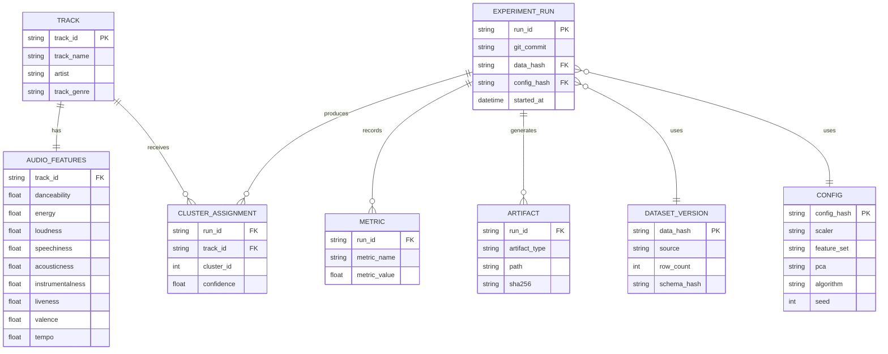
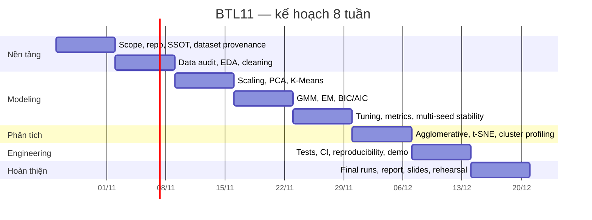

# BTL11 — Music Genre & Audio Track Segmentation

> **Trạng thái thực thi (2026-10-27):** specification này đã được triển khai trên snapshot Kaggle
> thật. Trạng thái hiện tại, run ID, bảng máy sinh, kiểm chứng và deliverable nằm ở `README.md`,
> `docs/REPORT.md`, `docs/DECISIONS.md`, `docs/EXPERIMENTS.md` và `artifacts/INDEX.csv`. Các bảng
> status/TODO bên dưới là kế hoạch trước thực thi, không phải trạng thái hiện tại. Raw CSV vẫn chưa
> được phép public cho tới khi con người xác minh license.

> **SSOT triển khai nghiên cứu và mã nguồn** | Version `1.0` | Ngày 2026-10-27 | Ngôn ngữ: tiếng Việt | Đối tượng: nhóm sinh viên, người phản biện, coding agents.

> File đề xuất trong repo: `docs/BTL11_SSOT.md`. Không phải báo cáo kết quả: chưa có dataset thật hoặc kết quả chạy thí nghiệm trong các file đính kèm.

## 0. QUY ƯỚC SSOT VÀ CONTRACT CHO CODING AGENTS (ĐỌC TRƯỚC KHI CODE)

**Tình trạng tài liệu:** SPECIFICATION / PLAN, cập nhật ngày 2026-10-27. **Chưa có file CSV Spotify thật trong các tệp được cung cấp; mọi con số thống kê, K tối ưu, chất lượng phân cụm, thời gian chạy, tên cụm và con số ROI chấm điểm là giả thuyết/ước lượng, KHÔNG PHẢI thực nghiệm đã thực hiện.** Slide và đề bài là nguồn bắt buộc; tài liệu kỹ thuật từ nhà phát triển là nguồn xác minh; mọi đề xuất kiến trúc/ưu tiên là quyết định thiết kế của nhóm, không phải yêu cầu giảng viên.

### 0.1 Thứ tự hiệu lực và từ khóa yêu cầu

1. **Đề bài `DATA MINING PROJECTS.docx`, mục III, số 11** > mọi đề xuất tự mở rộng ở tài liệu này.
2. **Bốn slide do giảng viên cấp** quyết định các chủ đề có giá trị để thể hiện; không có nghĩa phải sử dụng tất cả thuật toán của slide.
3. **Các quyết định APPROVED trong SSOT** dùng làm contract code; đề xuất ALTERNATIVE/OPTIONAL không được tự triển khai nếu core chưa xong.
4. **File CSV cụ thể + checksum + audit log** có thẩm quyền đối với các thống kê thực tế; web dataset card chỉ dùng để chuẩn bị schema dự kiến.
5. **Version code/dependency + run manifest** có thẩm quyền đối với con số trong báo cáo. Nếu report, notebook và artifact khác nhau, artifact đã chạy và được kiểm toán thắng; sửa report.

`MUST` = bắt buộc; `SHOULD` = mặc định làm, ngoại lệ phải được giải thích; `MAY` = tùy chọn; `DO NOT` = cấm. Từ khóa này có hiệu lực đối với các module, scripts, tests và agents.

### 0.2 Các quyết định kiến trúc mặc định (Decision Record)

| ID | Quyết định | Lý do | Điều kiện thay đổi |
|---|---|---|---|
| ADR-01 | Dùng snapshot CSV từ Kaggle Spotify Tracks Dataset được chỉ định | Bám đề, không lệch sang MIR/audio decoding | Giáo viên chấp thuận hoặc nguồn không thể sử dụng hợp lệ |
| ADR-02 | Bài toán chính là **unsupervised audio feature clustering**, không genre prediction | K-Means/GMM phân cụm theo âm học; genre dùng post-hoc | Không thay trong BTL11 |
| ADR-03 | `F9` là primary, `F5` là ablation | Nhiều đặc trưng liên quan, chi phí bổ sung thấp | Audit xác nhận cột không có hoặc quality kém |
| ADR-04 | `StandardScaler` primary, `RobustScaler` ablation | Khoảng cách Euclidean nhạy với đơn vị thang đo | Dữ liệu thực nghiệm bác bỏ |
| ADR-05 | K-Means + GMM bắt buộc; PCA bắt buộc, t-SNE hình minh họa | Đúng mục tiêu cụ thể của đề | Không bỏ K-Means/GMM |
| ADR-06 | Quét K theo giai đoạn; không mặc định thực hiện full Cartesian grid lớn | Giảm compute và tăng chất lượng lập luận | Ngân sách máy/thời gian dư |
| ADR-07 | Ward trên mẫu là **diagnostic có điều kiện** | Bao phủ phương pháp phân cấp của slide với ít code | Nếu sample vẫn nặng thì hạ cỡ mẫu/bỏ |
| ADR-08 | Decision Tree surrogate / association rules chỉ là extension | Phủ thêm 2 slide còn lại, nhưng tránh đổi trọng tâm | Sau khi hoàn thành các P0/P1 |
| ADR-09 | Không dùng genre, artist, tên bài, popularity, metadata thời gian làm input primary | Ngăn metadata shortcut / leakage | Chỉ ablation tách riêng, công bố minh bạch |
| ADR-10 | Mọi metric phải ghi **không gian đo**, tập quan sát, cách lấy mẫu và seed | Tránh so sánh sai và không tái lập | Không ngoại lệ |
| ADR-11 | Có thể chọn K-Means làm final và GMM complementary, hoặc ngược lại | Không cố ép một mô hình thắng | Dựa bảng đo thực |
| ADR-12 | CLI reproducible + artifacts + report > web app đẹp | Chất lượng khoa học là ưu tiên | Bảo đảm core trước demo |

### 0.3 P0/P1/P2 và điều kiện dừng

| Ưu tiên | Phần việc | Acceptance gate |
|---|---|---|
| **P0 — bắt buộc** | provenance; audit/cleaning; F5/F9; scaling; PCA; K-Means; GMM; K/model selection; 2D plot; cluster profile; báo cáo; CLI | Có thể chạy từ clean clone + dataset hợp lệ, không có số giả |
| **P1 — sweet spot** | t-SNE 2D; scaler/PCA ablation; đa seed/stability; BIC/AIC; GMM entropy; Ward subset; tests + CI; profiles đầy đủ | P0 pass, mỗi phần tạo ra kết luận có kiểm chứng |
| **P2 — conditional extensions** | Decision Tree surrogate, Apriori/FP-Growth rules, DBSCAN, dashboard local | Chỉ triển khai nếu P0/P1 không rủi ro và còn thời gian |
| **Out-of-scope** | Hệ gợi ý cá nhân hóa, audio crawling, Spotify API runtime, stream processing, PyTorch autoencoder trên 9D, cloud production | Không code trong giai đoạn chính |

**Stop rule:** nếu < 1/4 tổng quỹ thời gian còn lại mà P0 chưa được nghiệm thu, NGỪNG mọi P2 và phần Ward nếu cần; dành phần còn lại để chạy kết quả thật, kiểm thử, viết báo cáo và tập bảo vệ. Nếu chỉ đạt P0, vẫn có thể làm BTL đúng đề và trung thực; không tuyên bố chắc chắn đạt điểm tối đa vì không có rubric chấm điểm chính thức.

### 0.4 Yêu cầu bắt buộc đối với coding agent

- Trước khi tạo code, đọc SSOT và **liệt kê những quyết định đã khóa**; không tự đổi dataset/đề tài/feature set/logic tiền xử lý.
- Không mặc định `data/raw/dataset.csv` đã tồn tại. Nếu chưa có, chỉ được sinh **synthetic fixture trong `tests/fixtures/`** để phát triển, không dùng fixture thay kết quả nghiên cứu.
- Không tự truy cập, scrape, xin token, hoặc gọi Spotify Web API. Không công bố raw CSV ra public repo khi chưa được xác nhận quyền phân phối.
- Không tự bịa K tối ưu, silhouette, NMI, profiles hoặc thời gian chạy. Thống kê chỉ được lấy từ run artifacts của dữ liệu thật.
- Mọi bước fit PCA/scaler phải dùng `fit subset`; mọi transform test/validation dùng fitted transform, không refit trộm. `track_genre` không nằm trong feature matrix.
- Các interface chưa định nghĩa được bổ sung bằng PR/commit gắn ADR; không âm thầm thay kiến trúc. Tất cả chart/report có nguồn `run_id`.
- Đối với mỗi nhiệm vụ: viết/điều chỉnh test, chạy smoke test, ghi lệnh reproduce, mô tả kết quả và hạn chế; tạo PR nhỏ theo module thay vì một khối code không thể review.
- Không chạy grid hàng nghìn fits hoặc silhouette O(n²) full-scale mặc định. Phải có cờ `--dry-run`, `--sample-size`, `--max-runtime-minutes` hoặc tương đương.
- Nếu dataset hoặc nguồn hợp đồng chưa xác minh, tạo gate lỗi có hướng dẫn chứ không impute/điền giả cho qua.

### 0.5 Phân biệt những gì có và chưa có

| Phát biểu | Độ tin cậy |
|---|---|
| BTL11 yêu cầu K-Means, GMM, giảm chiều, trực quan, profile | **FACT — đề bài** |
| Slide có K-Means++, hierarchical/Ward, DBSCAN, silhouette, PCA, Apriori, decision tree | **FACT — slide** |
| Mirror của cùng tên dataset có 114k hàng và cột audio đã nêu | **WEB-SNAPSHOT**, chưa phải audit của CSV nhóm |
| F9 tốt hơn F5; K=6 tốt; clustering khớp genre | **HYPOTHESIS** cho đến khi thí nghiệm xác nhận |
| 80 hoặc 128 person-hours là đủ; Ward đem lại nhiều điểm | **PLANNING ASSUMPTION**, không phải thang điểm chính thức |

---


> **Vai trò của tài liệu:** đây là tài liệu SSOT (*Single Source of Truth*) cho toàn bộ BTL số 11. Mọi quyết định về phạm vi, dữ liệu, tiền xử lý, thuật toán, thí nghiệm, cấu trúc mã nguồn, đánh giá, tái lập, phân công và tiêu chí hoàn thành nên được cập nhật tại chính `docs/BTL11.md`, thay vì phân tán trong notebook hoặc tài liệu riêng.
>
> **Giả định lập kế hoạch:** dùng công cụ mã nguồn mở; Python + NumPy/Pandas + scikit-learn là stack chính. PyTorch chỉ dùng cho stretch goal nếu phần cốt lõi đã hoàn thiện. Không giả định có hạn chế CPU/GPU/RAM, nhưng thiết kế vẫn ưu tiên khả năng tái lập trên máy cá nhân.
>
> **Tên đề tài theo danh sách môn học:** **Music Genre & Audio Track Segmentation**. Yêu cầu gốc của BTL11 là chuẩn hóa và giảm chiều các đặc trưng âm thanh như `acousticness`, `danceability`, `energy`, `valence`, `tempo`; dùng **K-Means** và **Gaussian Mixture Models (GMM)** để phân cụm; dùng **PCA hoặc t-SNE** để chiếu cụm xuống 2D/3D; sau đó mô tả đặc trưng âm học trung bình của từng cụm. Dataset được chỉ định là **Kaggle Spotify Tracks Dataset**.

## Tóm tắt điều hành và phạm vi

**Khuyến nghị trung tâm:** không biến BTL11 thành một dự án “thử càng nhiều thuật toán càng tốt”. Cách có ROI điểm số cao hơn là xây dựng một pipeline phân cụm được kiểm chứng kỹ, có ablation, có mô hình toán học, có lựa chọn siêu tham số rõ ràng, có kiểm tra độ ổn định và có khả năng tái lập. “Sweet spot” đề xuất là:

**`Data audit → deduplication → StandardScaler/RobustScaler ablation → PCA → K-Means + GMM → Silhouette/DB/CH + BIC → multi-seed stability → t-SNE visualization → Agglomerative/Ward diagnostic → cluster profiling`**

Tập kỹ thuật này bám trực tiếp BTL11, đồng thời bao phủ phần lớn các chủ đề có giá trị trong slide *Data/Preprocessing* và *Cluster Analysis*. Slide môn học nhấn mạnh kiểu dữ liệu, thống kê, similarity/distance, cleaning, transformation và dimensionality reduction; slide clustering bao phủ K-Means, khởi tạo, K-Medoids, hierarchical clustering, density-based clustering, xác định số cụm và đánh giá bằng cả intrinsic/extrinsic metrics.

Không nên cố nhồi Classification và Pattern Mining vào MVP chỉ để tăng số chương. Slide Classification phân biệt supervised với unsupervised learning và trình bày decision tree, Bayes, lazy learners, linear classifiers, model selection; slide Pattern Mining tập trung support/confidence, Apriori, ECLAT, FP-Growth và pattern evaluation. Hai nhánh này có thể được khai thác hợp lý ở **stretch goals** dưới dạng decision-tree surrogate và association rules hậu nghiệm, nhưng không nên làm lu mờ mục tiêu clustering của BTL11.

**Kết quả cuối cùng cần trả lời được bốn câu hỏi khoa học:**

1. Các track có tạo thành cấu trúc cụm có ý nghĩa khi chỉ sử dụng đặc trưng âm học hay không?
2. K-Means và GMM tạo ra những phân đoạn khác nhau như thế nào, đặc biệt giữa hard clustering và probabilistic/soft clustering?
3. Số cụm nào là hợp lý khi xét đồng thời độ chặt, độ tách biệt, độ ổn định và độ phức tạp?
4. Các cụm có thể được diễn giải thành những “audio personas” rõ ràng, chẳng hạn *energetic/danceable*, *acoustic/low-energy*, *instrumental/ambient*, *speech-heavy*, hay không?

Các câu hỏi này phù hợp với bản chất của cluster analysis: chia các đối tượng thành nhóm sao cho các phần tử trong cùng nhóm tương tự nhau và khác với các nhóm khác; slide môn học cũng nhấn mạnh clustering là unsupervised learning và có thể dùng độc lập để hiểu cấu trúc dữ liệu hoặc làm bước trung gian cho các tác vụ data mining khác.

**Deliverable tối thiểu để được xem là hoàn thành tốt:**

| Deliverable | Điều kiện chấp nhận |
|---|---|
| Dataset có provenance | nguồn, SHA-256, schema, số dòng/cột thực tế, thống kê duplicate/missing |
| EDA | phân phối, skew/outlier, correlation, feature ranges, genre distribution chỉ để mô tả |
| Preprocessing | pipeline deterministic, scaler được so sánh bằng ablation |
| PCA | explained variance + loadings + thí nghiệm clustering trước/sau PCA |
| K-Means | quét nhiều `K`, nhiều seed, inertia + metrics |
| GMM | nhiều `K`, ít nhất `diag/full`, BIC/AIC, soft memberships |
| Evaluation | Silhouette, Davies–Bouldin, Calinski–Harabasz, stability; external validation tách biệt |
| Visualization | PCA 2D và t-SNE 2D; không dùng t-SNE để chọn mô hình |
| Interpretation | bảng profile cụm ở đơn vị feature gốc |
| Reproducibility | config, seed, dependency lock, data hash, CLI, test, CI |
| Report | lý thuyết, pseudocode, thí nghiệm, limitations, ablations, conclusion |
| Demo | CLI bắt buộc; web demo là optional |

**Kịch bản ước lượng nguồn lực (không phải thông tin đã được nhóm xác nhận):** giả định 4 thành viên, mỗi người trung bình 4 giờ/tuần trong 8 tuần, ta có khoảng

\[
4\ \text{người}\times8\ \text{tuần}\times4\ \text{giờ}
=\boxed{128\ \text{person-hours}}
\]

Đây là ngân sách đủ cho “sweet spot” nhưng chưa đủ để đồng thời làm tốt K-Means, GMM, DBSCAN, hierarchical, association mining, deep learning, web app và một loạt mô hình phụ. Vì vậy, nguyên tắc là **depth before breadth**.

## Bài toán, dữ liệu và nền tảng

**Định nghĩa bài toán.** Cho tập \(n\) track, mỗi track được biểu diễn bởi vector audio feature

\[
\mathbf{x}_i=(x_{i1},x_{i2},...,x_{id})\in\mathbb{R}^d,
\]

cần tìm ánh xạ

\[
f:\mathbb{R}^{d}\rightarrow\{1,\ldots,K\}
\]

hoặc, với GMM, phân phối xác suất hậu nghiệm

\[
p(z=k\mid\mathbf{x}_i),
\]

sao cho các track có đặc điểm âm học tương đồng được gom vào cùng phân đoạn.

Điểm quan trọng là `track_genre` **không phải target để train**. Nếu dùng genre trong quá trình chọn \(K\) hoặc chọn thuật toán, bài toán sẽ bị biến từ unsupervised discovery thành một dạng tối ưu hóa ngầm theo nhãn. `track_genre` chỉ được sử dụng **sau khi khóa mô hình chính** để thực hiện external/post-hoc validation. Với track multi-genre, dùng multi-label incidence heatmap; ARI/NMI một nhãn chỉ hợp lệ trên tập có nhãn đơn theo quy tắc cố định và công bố mẫu đánh giá. Scikit-learn phân biệt rõ intrinsic metrics — chỉ cần \(X\) và cluster labels — với external metrics như adjusted Rand, NMI, homogeneity/completeness khi có reference labels.

**Dataset chính.** Một bản mirror công khai (không phải file CSV đã được nhóm nạp/audit) của dataset được chỉ định cho thấy khoảng **114.000 dòng** và các cột gồm `track_id`, nghệ sĩ, album, track name, popularity, duration, explicit, `danceability`, `energy`, `key`, `loudness`, `mode`, `speechiness`, `acousticness`, `instrumentalness`, `liveness`, `valence`, `tempo`, `time_signature`, `track_genre`.

Có một điểm provenance đáng chú ý: một số dataset card mô tả nguồn này có “125 genres”, trong khi dataset viewer/mirror khác thể hiện **114 giá trị `track_genre`**. Vì vậy report tuyệt đối không hard-code con số genre theo mô tả trên web; pipeline phải tính trực tiếp `df["track_genre"].nunique()` trên artifact đã tải, ghi hash và xem chính file đó là nguồn sự thật.

**Link dataset chính:** [Kaggle — Spotify Tracks Dataset](https://www.kaggle.com/datasets/maharshipandya/-spotify-tracks-dataset)

### So sánh dataset ứng viên

| Dataset | Quy mô / nội dung | Điểm mạnh | Điểm yếu cho BTL11 | Vai trò đề xuất |
|---|---|---|---|---|
| **Spotify Tracks Dataset** | Mirror hiện có 114.000 track cùng metadata và audio features. | Khớp chính xác đề BTL11; features đã tabular; chạy clustering nhanh; trực quan dễ | Provenance/license cần kiểm tra; số genre mô tả không hoàn toàn nhất quán giữa mirror; không có raw audio | **Dataset chính, bắt buộc** |
| **FMA — Free Music Archive** | 106.574 track, 16.341 artist, taxonomy 161 genre; có audio, metadata và precomputed features; UCI ghi nhận clustering là một task phù hợp. | Nguồn nghiên cứu mạnh, audio Creative-Commons theo paper, có raw audio và features | Lớn; chuyển feature schema làm tăng workload; không còn bám chặt đề gốc | **Secondary robustness dataset** nếu dư thời gian |
| **GTZAN** | 1.000 track, 30 giây/track, 10 genre × 100, WAV 22.05 kHz mono. | Nhỏ, dễ demo feature extraction/MIR | Phải tự trích đặc trưng; quá nhỏ so với Spotify; chuyển trọng tâm sang audio processing | Stretch cho PyTorch/audio feature extraction, **không nên dùng chính** |

FMA đặc biệt hấp dẫn về mặt học thuật: paper gốc giới thiệu 106.574 track, 343 ngày audio, 917 GiB toàn bộ tài nguyên, metadata, text và precomputed features; repository chính còn cung cấp `fma_small`, `fma_medium`, `fma_large` cùng metadata. Tuy nhiên điều này không đủ để biện minh cho việc thay dataset được giáo viên chỉ định nếu mục tiêu ưu tiên là điểm số.

**Cảnh báo nguồn Spotify năm 2026.** Không nên xây thêm pipeline gọi Spotify Web API để làm giàu dataset. Tài liệu Spotify hiện yêu cầu Premium để dùng Web API, và các reference page hiện hiển thị policy note rằng Spotify Platform/Content không được dùng để train hoặc ingest vào ML/AI model; một số track endpoints cũng đã được đánh dấu deprecated. Vì vậy, phương án ít rủi ro nhất cho BTL là sử dụng **static snapshot do đề bài chỉ định**, lưu provenance/hash, không tải thêm audio/metadata từ Spotify API và không triển khai live integration. Nhóm vẫn cần đọc điều khoản của chính artifact Kaggle trước khi public repository; đây là quản trị rủi ro, không phải tư vấn pháp lý.

**Feature set đề xuất.**

| Tập feature | Thành phần | Vai trò |
|---|---|---|
| `F5-required` | `acousticness, danceability, energy, valence, tempo` | Bám đúng ví dụ trong yêu cầu BTL11 |
| `F9-audio` | F5 + `loudness, speechiness, instrumentalness, liveness` | **Feature set chính**: tăng richness với chi phí gần như bằng 0 vì tất cả đã có trong dataset. |
| `F9+music-structure` | F9 + engineered `key`, `mode`, `time_signature` | Ablation/stretch |
| Metadata | popularity, duration, explicit, artist, album, title | Không dùng trong primary clustering; chỉ mô tả hoặc ablation riêng |

Không nên đưa `popularity` vào feature chính vì mục tiêu là **audio segmentation**, không phải segment theo độ nổi tiếng; `artists`, `track_name`, `album_name`, `track_id` là định danh/text metadata chứ không phải tọa độ phù hợp cho Euclidean audio space. `key` cũng không nên đưa trực tiếp dưới dạng số 0–11 vì 11 không “xa” 0 theo ngữ nghĩa pitch-class giống như số thực tuyến tính. Nếu thử `key`, nên dùng:

\[
key_{\sin}=\sin(2\pi key/12),\qquad
key_{\cos}=\cos(2\pi key/12).
\]

`mode` có thể giữ nhị phân; `time_signature` nên xem là categorical/ordinal và chỉ đưa vào ablation khi có lập luận rõ.

**Data contract bắt buộc.** Pipeline phải kiểm tra trước khi chạy thí nghiệm:

```text
track_id                  string
danceability              float
energy                    float
loudness                  float
speechiness               float
acousticness              float
instrumentalness          float
liveness                  float
valence                   float
tempo                     float
track_genre               string   # chỉ post-hoc validation
```

Mọi thay đổi schema phải làm pipeline fail-fast, thay vì âm thầm bỏ cột.

**Cleaning protocol:**

- Xóa cột index kiểu `Unnamed: 0` nếu tồn tại.
- Đếm missing theo cột; không được tuyên bố “dataset không missing” chỉ dựa vào dataset card.
- Tính `nunique(track_id)`, số duplicate ID, số row duplicate hoàn toàn. Nếu cùng `track_id` lặp lại, audit tính nhất quán của audio vector trước khi deduplicate; các giá trị `track_genre` phải được bảo toàn ở bảng one-to-many `track_genres`, theo protocol bổ sung. Ghi số dòng trước/sau và mọi vector mâu thuẫn.
- Kiểm tra finite values, `NaN`, `inf`, range và quantiles.
- Không winsorize/xóa outlier một cách mặc định. Outlier có thể là track thật sự khác biệt; chỉ xử lý khi có bằng chứng và phải chạy ablation.
- Giữ một cột `row_id` hoặc `track_id` ổn định để join cluster assignment ngược về metadata.
- Tách `X_audio` khỏi `metadata` ngay sau bước validation để không vô tình đưa genre/name/popularity vào mô hình.

Slide môn học dành một phần lớn cho data quality, cleaning, integration, transformation, similarity/distance và dimensionality reduction, nên phần data audit không phải “phần phụ”; nó trực tiếp thể hiện kiến thức chương Data.

**Scaling là bắt buộc.** K-Means tối thiểu hóa khoảng cách Euclidean và do đó phụ thuộc mạnh vào scale; `tempo` và `loudness` có thang đo hoàn toàn khác các feature 0–1. `StandardScaler` đưa feature về zero mean/unit variance, còn `RobustScaler` dựa trên các statistics robust hơn với outlier.

Primary:

\[
z_{ij}=\frac{x_{ij}-\mu_j}{\sigma_j}.
\]

Ablation:

\[
z^{robust}_{ij}
=\frac{x_{ij}-\operatorname{median}(x_j)}
{Q_{0.75}(x_j)-Q_{0.25}(x_j)}.
\]

Không chọn scaler bằng cảm tính; chạy cả hai và đo cluster validity/stability.

## Phương pháp và thuật toán

**Pipeline toán học tổng quát:**

\[
X_{\text{raw}}
\rightarrow
X_{\text{clean}}
\rightarrow
X_{\text{scaled}}
\rightarrow
\begin{cases}
X_{\text{scaled}}\\
X_{\text{PCA}}
\end{cases}
\rightarrow
\{\text{K-Means},\text{GMM},\text{Agglomerative}\}
\rightarrow
\text{Evaluation}
\rightarrow
\text{Profiling}.
\]

PCA và t-SNE có vai trò khác nhau: **PCA có thể là một phần của modeling pipeline**, còn **t-SNE chỉ dùng để trực quan hóa**. PCA trong scikit-learn tìm các thành phần trực giao liên tiếp tối đa hóa phương sai; scikit-learn PCA center dữ liệu nhưng không tự scale feature trước SVD, vì vậy scaling phải diễn ra trước PCA.

**K-Means.** Với \(K\) cụm \(C_1,\ldots,C_K\), centroid \(\mu_k\), bài toán là:

\[
\underset{C_1,\ldots,C_K}{\min}
J
=
\sum_{k=1}^{K}
\sum_{\mathbf{x}_i\in C_k}
\|\mathbf{x}_i-\boldsymbol{\mu}_k\|_2^2.
\]

Đây chính là inertia/within-cluster sum of squares trong scikit-learn và cũng phù hợp công thức SSE trình bày trong slide môn học.

Centroid:

\[
\boldsymbol{\mu}_k=
\frac{1}{|C_k|}
\sum_{\mathbf{x}_i\in C_k}\mathbf{x}_i.
\]

Pseudocode:

```text
INPUT: X, K
INITIALIZE K centroids bằng k-means++

repeat:
    for mỗi điểm xi:
        gán xi vào cluster có centroid gần nhất
        ci ← argmin_k ||xi - μk||²

    for mỗi cluster k:
        μk ← mean({xi | ci = k})

until centroid thay đổi < tolerance
   hoặc đạt max_iter

RETURN assignments, centroids, inertia
```

Slide môn học cũng chỉ rõ K-Means nhạy với initialization và có thể hội tụ tại local optimum; k-means++ được trình bày như cải tiến khởi tạo. Scikit-learn hiện dùng `k-means++` để chọn centroid ban đầu thông minh hơn random initialization. Vì vậy không dùng `n_init=1`; đề xuất ghi explicit `n_init=20` để kết quả không phụ thuộc vào thay đổi default giữa các version.

**Gaussian Mixture Model.** GMM giả định dữ liệu được sinh từ hỗn hợp \(K\) Gaussian:

\[
p(\mathbf{x})
=
\sum_{k=1}^{K}
\pi_k
\mathcal{N}(\mathbf{x}\mid\boldsymbol{\mu}_k,\Sigma_k),
\]

trong đó

\[
\pi_k\ge0,\qquad
\sum_k\pi_k=1.
\]

Khác K-Means, GMM cho **soft membership**:

\[
\gamma_{ik}
=
P(z_i=k\mid \mathbf{x}_i)
=
\frac{
\pi_k\mathcal{N}
(\mathbf{x}_i\mid\mu_k,\Sigma_k)
}{
\sum_{j=1}^{K}
\pi_j\mathcal{N}
(\mathbf{x}_i\mid\mu_j,\Sigma_j)
}.
\]

Điều này đặc biệt phù hợp âm nhạc vì một track có thể nằm gần biên giữa “acoustic”, “energetic” hoặc “danceable” personas thay vì thuộc tuyệt đối một nhóm.

GMM được fit bằng **Expectation–Maximization (EM)**. Paper kinh điển của Dempster, Laird và Rubin mô tả EM như một thuật toán tổng quát để tính maximum-likelihood estimates khi có latent/incomplete data và bao gồm finite-mixture models.

E-step:

\[
\gamma_{ik}
\leftarrow
P(z_i=k\mid\mathbf{x}_i,\theta).
\]

M-step, với \(N_k=\sum_i\gamma_{ik}\):

\[
\mu_k
=
\frac{1}{N_k}\sum_i\gamma_{ik}\mathbf{x}_i,
\]

\[
\Sigma_k
=
\frac{1}{N_k}
\sum_i
\gamma_{ik}
(\mathbf{x}_i-\mu_k)(\mathbf{x}_i-\mu_k)^T,
\]

\[
\pi_k=\frac{N_k}{n}.
\]

Pseudocode:

```text
INPUT: X, K, covariance_type

khởi tạo πk, μk, Σk

repeat:
    # E step
    với mọi i, k:
        tính responsibility γik

    # M step
    với mỗi k:
        Nk ← Σi γik
        μk ← Σi γik xi / Nk
        Σk ← weighted covariance
        πk ← Nk / n

    tính log-likelihood

until Δlog-likelihood < tolerance
   hoặc đạt max_iter

RETURN π, μ, Σ, responsibilities
```

Scikit-learn `GaussianMixture` hỗ trợ covariance `full`, `tied`, `diag`, `spherical`; model selection có thể xét đồng thời số component và covariance structure. Sweet spot chỉ cần **`diag` và `full`** trong main sweep; `tied/spherical` là stretch.

**PCA.** Sau chuẩn hóa, PCA tìm các hướng trực giao \(w_j\) tối đa hóa variance:

\[
w_1
=
\arg\max_{\|w\|=1}
\operatorname{Var}(Xw).
\]

Với covariance matrix \(S\):

\[
Sw_j=\lambda_jw_j,
\]

trong đó \(\lambda_j\) là variance giải thích bởi principal component \(j\). Tỷ lệ variance tích lũy:

\[
R_m=
\frac{\sum_{j=1}^{m}\lambda_j}
{\sum_{j=1}^{d}\lambda_j}.
\]

Không nên chỉ dùng `PCA(n_components=2)` làm dữ liệu clustering. 2D chủ yếu phục vụ hình; modeling experiment nên so sánh:

```text
no PCA
PCA giữ >= 90% variance
PCA giữ >= 95% variance   <- primary candidate
```

Nếu F9 chỉ có chín chiều, PCA không cần thiết về computational efficiency; giá trị của PCA ở đây chủ yếu là decorrelation, noise reduction, visualization và minh họa dimensionality reduction của môn học.

**t-SNE.** t-SNE tạo embedding thấp chiều bằng cách bảo toàn cấu trúc láng giềng theo phân phối xác suất và tối thiểu hóa KL divergence:

\[
KL(P\|Q)
=
\sum_{i\ne j}
p_{ij}
\log\frac{p_{ij}}{q_{ij}}.
\]

Paper gốc giới thiệu t-SNE như kỹ thuật bố trí điểm high-dimensional trên bản đồ 2D/3D. Tuy nhiên chính tài liệu scikit-learn cảnh báo optimization là non-convex và kết quả phụ thuộc initialization/perplexity; kích thước, khoảng cách và hình dạng các cụm trong t-SNE không nên bị diễn giải như metric geometry chính xác.

Do đó:

> **Không dùng t-SNE để quyết định K, không tính Silhouette trên tọa độ t-SNE, không kết luận “hai cụm xa nhau” chỉ vì chúng trông xa trên hình t-SNE.**

t-SNE chỉ là hình minh họa sau khi cluster labels đã được tạo trong feature/PCA space.

**Agglomerative/Ward diagnostic.** Hierarchical clustering là chủ đề lớn của slide, với agglomerative/divisive clustering, dendrogram, single/complete/average/Ward linkage. Ward merge các cluster sao cho mức tăng within-cluster variance nhỏ nhất. Nó là optional nhưng có ROI cao vì thêm được một họ phương pháp khác với khoảng 6 person-hours.

Không chạy unconstrained Agglomerative trên toàn bộ 114k track trong MVP: tài liệu scikit-learn lưu ý agglomerative clustering không có connectivity constraints sẽ tốn kém khi số sample lớn vì cần xét các phép merge có thể xảy ra. Giải pháp chấm điểm tốt hơn là chọn deterministic sample, ví dụ tối đa 2.000 track (tăng lên sau benchmark), rồi chạy Ward quanh \(K^\*\) của K-Means/GMM.

### So sánh thuật toán ứng viên

| Thuật toán | Kiểu cluster | Ưu điểm cho BTL11 | Nhược điểm | Quyết định |
|---|---|---|---|---|
| **K-Means** | hard, centroid, gần spherical/equal-variance | Chính đề; dễ giải thích; scalable; centroid profile trực quan | Nhạy scale/outlier/initialization; phải cho \(K\) | **Bắt buộc, primary** |
| **GMM** | probabilistic ellipsoidal | Chính đề; soft membership; covariance mô tả hình dạng | Nặng hơn K-Means; local optimum; covariance có thể singular | **Bắt buộc, primary** |
| **Agglomerative Ward** | hierarchical | Bao phủ slide hierarchical; so sánh cấu trúc merge | Khó scale toàn dataset | **Sweet-spot diagnostic** |
| K-Medoids | centroid là data point | Robust hơn với outlier; slide môn học có PAM/K-Medoids | Tăng dependency/cost, ít giá trị hơn đối với đề gốc | Không chọn |
| DBSCAN | density-based + noise | Không cần biết \(K\), tìm non-convex shape, noise; scikit-learn hỗ trợ trực tiếp. | `eps` khó tune trong 9D; high-dimensional distances; implementation có thể tốn \(O(n^2)\) memory ở worst case. | Stretch |
| Autoencoder + clustering | learned representation | Dùng được PyTorch, “ấn tượng” | Scope creep lớn; tabular 9D không cần deep model | Không làm trước core |

### Các metric và ý nghĩa

| Metric | Công thức / ý nghĩa | Hướng tốt | Dùng khi nào | Hạn chế |
|---|---|---:|---|---|
| **Inertia/SSE** | \(\sum_i\|x_i-\mu_{c_i}\|^2\) | ↓ | K-Means, elbow | Giảm gần như đơn điệu khi \(K\) tăng; không đủ để chọn K một mình. |
| **Silhouette** | \(s(i)=\frac{b(i)-a(i)}{\max(a(i),b(i))}\) | ↑, max 1 | Primary intrinsic metric | Ưa các cluster tách biệt theo metric đang dùng. |
| **Davies–Bouldin** | similarity mỗi cluster với cluster gần/giống nhất | ↓, min 0 | Intrinsic cross-check | Geometry-dependent. |
| **Calinski–Harabasz** | between-cluster dispersion / within-cluster dispersion | ↑ | Intrinsic cross-check | Có thể ưu tiên cấu trúc convex. |
| **BIC** | \(-2\log L+p\log n\) | ↓ | GMM model selection | Chỉ trực tiếp có ý nghĩa cho likelihood model |
| **AIC** | \(-2\log L+2p\) | ↓ | GMM secondary | Penalize complexity ít mạnh hơn BIC |
| **Stability ARI** | similarity giữa assignments từ seed/bootstrap khác nhau | ↑ | Robustness | Không đo semantic usefulness |
| **NMI/ARI vs genre** | agreement với `track_genre` | ↑ | **Post-hoc only** | Genre không nhất thiết trùng acoustic cluster; không dùng để tune primary model. |

Rousseeuw đưa ra silhouette như cách biểu diễn mức độ một object phù hợp với cluster của nó và average silhouette có thể được dùng cho cluster validation/chọn số cluster. Slide môn học cũng kết thúc phần cluster evaluation bằng Silhouette Coefficient sau các nội dung clustering tendency, number of clusters, extrinsic metrics và Dunn Index.

**Quy tắc chọn mô hình không nên là `argmax(silhouette)` duy nhất.** Đề xuất:

1. Loại mô hình có cụm cực nhỏ không giải thích được hoặc collapse.
2. Ưu tiên vùng \(K\) nơi Silhouette cao và tương đối ổn định.
3. Xác nhận bằng Davies–Bouldin thấp và Calinski–Harabasz cao.
4. Đòi hỏi stability qua nhiều seed.
5. Với GMM, dùng BIC như criterion chính về model complexity; scikit-learn minh họa selection đồng thời covariance type và component count bằng BIC/AIC.
6. Nếu hai model gần ngang nhau, chọn model đơn giản hơn/ít cụm hơn.
7. Chỉ sau khi khóa model mới mở `track_genre` để đánh giá external agreement.

## Phần bắt buộc bổ sung: khoa học dữ liệu đúng chuẩn, tránh lỗi học thuật

### 1. Đơn vị phân tích, trùng lặp và nhãn genre đa trị

**Chọn đơn vị phân tích primary là một track audio (ưu tiên `track_id`)**, không phải một hàng thể loại. Một track có thể được gán nhiều `track_genre` trên các hàng khác nhau, tức cùng `track_id` có thể lặp lại mà không đồng nghĩa với “bản ghi bẩn”. Nếu giữ nguyên nhiều bản sao sẽ ngầm tăng trọng số những track được gán nhiều thể loại, làm dịch chuyển centroid và giả tạo density.

Data audit MUST báo cáo: `n_rows`, `n_unique_track_ids`, `n_exact_duplicate_rows`, `n_duplicate_track_ids`, phân phối số hàng theo `track_id`, `n_tracks_with_multiple_genres`, `n_tracks_with_conflicting_audio_vectors`, số null/invalid `track_id`, và ví dụ minh họa có thể kiểm tra. Pipeline primary:

1. Chuẩn hóa ID chuỗi (giữ nguyên ký tự; trim whitespace khi thật sự là lỗi export), loại index cột `Unnamed: 0` nếu có.
2. Gom `track_id` hợp lệ; kiểm tra các vector F9 theo tolerance cấu hình (`atol=1e-8`, `rtol=1e-6` mặc định chỉ là ngưỡng kỹ thuật, không phải “sự thật domain”).
3. Nếu các vector cùng ID đồng nhất trong tolerance: giữ **một** hàng đại diện deterministic, bảo toàn toàn bộ genre liên quan trong bảng `track_genres` với khóa `(track_id, genre)`.
4. Nếu cùng ID có audio features mâu thuẫn: **audit và fail/đưa quarantine** khi chưa xác định nguyên nhân; **không tự lấy dòng đầu hoặc trung bình các audio vectors** rồi coi là bản gốc. Report tỷ lệ và đưa ra ADR riêng nếu cần giải quyết.
5. Nếu ID thiếu: cách an toàn là quarantine; một subset bổ sung theo metadata composite key có thể làm sensitivity analysis, nhưng **không trộn vào primary** nếu chưa kiểm tra.
6. Cuối bước cleaning: `tracks.track_id` là unique, `track_genres` có thể one-to-many, `row_count_before/after` và mapping được lưu; mọi phân cụm chạy trên `tracks`.

**Với post-hoc genre validation:** không tùy tiện ép track nhiều genre thành một nhãn ngẫu nhiên. Primary ưu tiên heatmap `cluster × genre` với **multi-label incidence**: số track trong cụm có genre đó, và `% unique tracks in cluster containing genre` (một hàng có thể tổng >100%). Với ARI/NMI dựa một nhãn, dùng tập **single-genre-only** và ghi `n_eval`, hoặc một quy tắc đơn nhãn được xác định trước (không cherry-pick); giải thích hạn chế chọn mẫu. Genre taxonomy không tương đương các “audio personas”.

**Không leak ID giữa fit và held-out:** split bằng hash của unique `track_id` *sau dedup*, không random row split. Như vậy cùng một track không thể nằm ở cả train và holdout.

### 2. Chiến lược fit/selection/validation nhất quán

Mặc định duy trì hai đường chạy rõ ràng, không nhập nhằng:

- **Research/dev path**: trên dữ liệu track đã audit, chia `development` 80% và `holdout` 20% bằng stable hash ID + seed. Fit scaler/PCA/K-Means/GMM trên development (hoặc fit subtrain, select trên validation nội bộ nếu đủ sức), chọn K và điều chỉnh cấu hình trên development. Dùng holdout **một lần** sau freeze để kiểm tra generalization: KMeans/GMM `predict()` trên track chưa dùng để fit, tính metrics phù hợp bằng cùng learned representation và same evaluation cohort. Nếu lựa chọn theo holdout lặp lại, nó mất tính độc lập; phải nói rõ.
- **Production-for-report path**: sau khi khóa cấu hình, refit preprocessing+model trên **tất cả unique tracks** để xuất assignment đầy đủ, profiles và demo. Kết quả refit toàn bộ **khác phiên bản mô hình** với holdout model; run manifest phải phân biệt `evaluation_model` và `final_refit_model`.

Clustering là unsupervised, không có nghĩa **phải** có train/test accuracy như classification. Holdout ở đây chứng minh tính ổn định/cấu trúc khi gặp track mới, không chứng minh “nhãn đúng”. Đặc biệt Ward/agglomerative truyền thống chỉ là `fit_predict` trên subset; không kỳ vọng `.predict()` cho track mới.

**Cố định cohort để so sánh**: mọi candidate trong một sweep phải dùng cùng danh sách `track_id` fit và cùng danh sách đánh giá; nếu chọn sampling theo cluster, cách lấy mẫu phải được khóa từ trước hoặc nói rõ. Khi so sánh F5/F9, các model được đo trên những feature spaces khác nhau; hãy ghi khoảng cách/metrics là *contextual*, không kết luận trực tiếp feature set này “tốt hơn” chỉ vì raw silhouette cao hơn mà không có consistency/interpretability checks.

### 3. Chi phí đo silhouette và cách vận hành khả thi

Với `n=114000`, ma trận khoảng cách dense toàn cặp có `n² = 12,996,000,000` phần tử; dùng float64 tương đương **103,968,000,000 bytes ≈ 96.83 GiB** chỉ cho một ma trận. Đây là phép tính minh họa **nếu materialize ma trận**, không khẳng định API scikit-learn luôn phân bổ một ma trận dense như vậy. Do đó không được mặc định `silhouette_score(X_all, labels_all)` full-size cho từng cấu hình.

**Policy primary:** chọn một **fixed cohort tối đa 3.000–5.000 unique tracks** (mặc định 3.000) để score silhouette trong vòng quét rộng; dùng `silhouette_score(X_cohort, pred_cohort, metric='euclidean')`. Guard `2 <= n_clusters_in_cohort <= n_cohort-1`. Có thể dùng `sample_size=3000, random_state=...` nhưng cohort tự kiểm soát được là tốt hơn khi muốn đảm bảo cùng track giữa các candidate. Nếu cluster quá hiếm khiến cohort bỏ sót, thực hiện một **secondary cluster-stratified diagnostic** sau chọn mô hình (không tráo primary metric). Tăng 5k/10k chỉ với finalists nếu tài nguyên cho phép, logging `n_score`, time, memory.

Davies–Bouldin và Calinski–Harabasz có thể tính trên tập lớn hơn; mọi chỉ số phải có `eval_sample_size` rõ ràng. Đừng xem silhouette khoảng 0.05–0.15 là thất bại tự động: các đoạn âm nhạc thường có biên liên tục/overlap; cần đặt trong bối cảnh baseline, size distribution, stability và profiles.

### 4. BIC/AIC và khả năng so sánh

Khi GaussianMixture fit trên `n` vector chiều `d`:

\[
\operatorname{BIC}=-2\log \hat L+p\ln n,\qquad
\operatorname{AIC}=-2\log \hat L+2p.
\]

Với `K` components, `d` chiều:

- `diag`: \(p=(K-1)+Kd+Kd=K(2d+1)-1\).
- `full`: \(p=(K-1)+Kd+K\frac{d(d+1)}2\).
- Ví dụ minh họa `d=9, K=12`: `diag p = 227`, `full p = 659`. Đây là phép **đếm tham số**, không phải kết quả fit.

**BIC/AIC chỉ so trực tiếp trong cùng dataset/cohort và cùng không gian feature đã biến đổi**, với likelihood có cùng base measure; không vẽ một trục BIC rồi xếp hạng trực tiếp GMM(F5), GMM(F9), GMM(PCA95) hoặc GMM(Standard) vs GMM(Robust). Thay đổi chiều/scale làm thay đổi ý nghĩa mật độ và log-likelihood (và có thể thêm log-Jacobian), nên các trị BIC đó không so ngang mà không hiệu chỉnh thống kê phù hợp. Mỗi feature/scaler/PCA setting có **BIC curve riêng** để chọn `K/covariance`; so chéo dựa validity, stability, profile, đơn giản hóa và held-out log-likelihood nếu biểu diễn tương thích.

Ngoài ra **BIC thấp không đồng nghĩa âm học/genre tốt**. GMM là mô hình density; mixture Gaussian cũng có thể chia một phân phối phi-Gaussian thành nhiều component để fit density mà không tương ứng nhóm ngữ nghĩa. Ghi rõ hard label của GMM là `argmax(predict_proba)`; member probabilities là hậu nghiệm **bên trong mô hình được fit**, không phải xác suất track thuộc thể loại âm nhạc khách quan.

### 5. Hai lớp bất định của GMM và kỹ thuật giải thích

Với `γ_ik = P(z=k | x_i, θ_hat)`:

- `confidence_i = max_k γ_ik` (range `[1/K, 1]`).
- `entropy_i = - Σ_k γ_ik log γ_ik` (nats); dùng `normalized_entropy = entropy / log K` khi `K>=2` để so sánh khác K.
- Gọi `borderline` theo **phân vị cohort** (ví dụ 10% confidence thấp nhất), không tự đặt `p<0.6` rồi khẳng định bất thường vì threshold chịu ảnh hưởng số component.

Xem 5–10 track đại diện mỗi cụm: medoid gần centroid (track có thật), extremes và borderline. In feature values + track name/artist từ local metadata; không tải audio/album art từ API. Dùng **median và IQR** cùng mean để mô tả vì nhiều audio feature lệch mạnh và có spike tại 0. Tránh dùng radar chart 9 chiều trên đơn vị gốc khác nhau; radar nếu có phải minh thị chuẩn hóa chỉ cho mục đích hiển thị, cùng scale chung; bảng kết luận vẫn ở đơn vị gốc.

### 6. Metric định lượng và quy tắc chọn final theo đa mục tiêu

| Tiêu chí | Ý nghĩa / hạn chế | Ưu tiên |
|---|---|---|
| Validity | Silhouette ↑, DB ↓, CH ↑, chú ý cùng space/cohort | P0 |
| Fit likelihood | GMM BIC/AIC thấp trong **cùng** space; held-out log-likelihood là check | P0 |
| Stability | Pairwise ARI nhiều `random_state` khi predict **cùng fixed reference cohort**; stability khi bootstrap dữ liệu fit | P1 |
| Coverage | `n_clusters_`, % cluster size, entropy của size distribution, empty/collapse | P0 |
| Interpretability | top +/- standardized deviation so với toàn bộ, profile raw units, representative tracks | P0 |
| Parsimony | Nếu chất lượng tương tự, chọn K nhỏ hơn, pipeline đơn giản, ít covariance params | P0 |
| External sanity | genre composition / single-genre ARI+NMI, **không chọn model theo genre** | P1 |
| Resource | fit/runtime/memory và số lỗi convergence, máy đo rõ | P1 |

**Stability về mặt tập dữ liệu:** không lấy ARI trực tiếp từ label trên hai bootstrap **không cùng track**, điều đó vô nghĩa. Mỗi bootstrap fit trên resample development nhưng dự đoán lên **cùng evaluation reference IDs**; sau đó ARI cặp. KMeans `n_init` cao có thể ổn định qua seed nên thêm bootstrap hữu ích. Nếu một thuật toán không hỗ trợ predict trên reference, so sánh Ward tại **cùng sample** với cùng tập IDs, không gọi đó là generalization.

**Selection workflow:** loại runs lỗi/degenerate → nhìn multi-metric Pareto set → xác nhận bootstrap stability → BIC chọn GMM K/cov within space → profile human-check → khóa final + ghi lý do. Không có weighted composite “điểm chất lượng” được tự xưng là rubric giảng viên; utility/ROI chỉ dùng quản lý nội bộ.

### 7. Độ trung thực của PCA và t-SNE

`PCA(n_components=0.95)` dùng để giữ tối thiểu 95% variance sau StandardScaler; giá trị số chiều **do dữ liệu quyết định** và ghi cụ thể. PCA có `components_`, `explained_variance_ratio_`, biplot/loadings; `whiten=False` default. PCA giúp linear projection, không đảm bảo 95% variance = 95% thông tin phân cụm. Thí nghiệm MUST có **no PCA** so với **PCA95** trên cùng fit split, và **PCA90** nếu tiết kiệm compute.

`PCA(n_components=2)` và `t-SNE` dùng để **vẽ**, không phải thay feature space âm học trong lựa chọn chính trừ khi có thí nghiệm được định danh rõ. Với t-SNE, **cùng subset track IDs, cùng seed** để overlay labels K-Means/GMM, và nếu vẽ nhiều hình cùng tập nên reuse embedding thay vì fit t-SNE riêng cho mỗi model (tránh hình khác nhau do stochasticity). `perplexity < n_samples`, không giải thích kích thước/khoảng cách 2D là khoảng cách tương đương trên 9D. Không đánh giá Silhouette trên t-SNE plot.

### 8. Hợp lệ dữ liệu, leakage và audit giao diện

- Với F9: `acousticness,danceability,energy,valence,speechiness,instrumentalness,liveness` dự kiến 0–1; `tempo>=0` và `loudness` là số hữu hạn. Những trường hợp lạ như `tempo=0`, `loudness>0`, hay `time_signature=0` là **flags để điều tra**, không mặc định loại tất cả.
- `key` định danh pitch-class và có thể có sentinel ngoài 0–11 theo nguồn khác; không làm continuous metric. `duration_ms<=0`, `popularity<0` không dùng để train nhưng vẫn là quality flags của metadata.
- Nếu cần xử lý missing trong numeric fit: report count trước, chọn drop/quarantine khi tỉ lệ thấp; nếu impute, `SimpleImputer` phải `fit` chỉ trên development và ghi tỷ lệ, kết quả ablation. **Không default impute lặng lẽ**.
- Không để `track_id`, `track_genre`, `genre_count`, `index`, `artist`, `track_name`, `album`, `popularity`, `duration_ms`, `explicit` nằm trong `X_primary`. Metadata chỉ join theo stable ID sau pred.
- Mọi feature vector input inference MUST validate ordered list F9; phải reject thiếu/extra nếu strict, không dựa vào thứ tự cột ngẫu nhiên.
- Split code phải assert disjoint IDs; transformed matrices MUST finite, shape đúng, không có NaN; `transformed_feature_names` được serialise cùng pipeline.
- Nếu dùng surrogate tree, target là **cluster_id do model unsupervised sinh ra**, không phải genre label; metric là surrogate agreement/fidelity trên held-out, không phải genre classification Accuracy. Con số này không chứng minh nhãn thật.
- Nếu dùng FP-Growth/Apriori cho profile, mẫu transaction mỗi track là các bin feature dựa trên ngưỡng training/reference distribution (`energy_high`, `valence_low`, ...) và item `cluster=Ck`. Rules dùng `support`, `confidence`, `lift`; chỉ trình bày luật `X_features -> cluster` (không ngược mục tiêu). Ngưỡng bin/genre không được tối ưu theo nhãn để tạo rule “đẹp”; association **không hàm ý nhân quả**.

### 9. Rủi ro quyền dữ liệu (đánh giá compliance bắt buộc)

Dataset mirror Hugging Face hiển thị thẻ license `bsd`, nhưng **metadata do uploader cung cấp không tự chứng minh quyền cấp lại tất cả dữ liệu Spotify**. Spotify Developer Policy (effective 2025-05-15) có điều khoản hạn chế sử dụng Spotify Platform/Content trong ML/AI; bản cập nhật nhà phát triển 2026 tiếp tục siết điều kiện truy cập. **Không khẳng định** rằng dùng tệp CSV tĩnh từ bên thứ ba chắc chắn được miễn các điều khoản đó. Kế hoạch an toàn: cần kiểm tra license thực tế ở Kaggle và nguồn gốc tập dữ liệu, quy định của trường, và nếu không chắc thì tham vấn giảng viên/đơn vị phụ trách; không public raw data, không mở Spotify Web API, không deploy thương mại. Nếu việc sử dụng không được phép, ghi blocker và xin phương án dataset thay thế có phép sử dụng phù hợp trước khi chạy.

Nguồn gốc quan trọng: [Kaggle dataset](https://www.kaggle.com/datasets/maharshipandya/-spotify-tracks-dataset), [Hugging Face mirror/card](https://huggingface.co/datasets/maharshipandya/spotify-tracks-dataset), [Spotify Developer Policy](https://developer.spotify.com/policy), [Spotify developer announcement 2026-02-06](https://developer.spotify.com/blog/2026-02-06-update-on-developer-access-and-platform-security).

---


## Thiết kế thí nghiệm và sweet spot

**Protocol chính.** Mỗi experiment phải sinh một `run_id`, config hoàn chỉnh, seed, data hash, git commit, thời gian chạy, metric và artifact. Không được chỉnh notebook rồi copy con số đẹp vào report.

Đề xuất `K ∈ {2,...,12}` trước. Nếu metric tốt nhất ở biên 12, mở rộng lên 15 hoặc 20; không mở rộng mặc định để tránh search vô hạn.

**K-Means grid:**

```yaml
algorithm: kmeans
k: [2, 3, 4, 5, 6, 7, 8, 9, 10, 11, 12]
init: k-means++
n_init: 20
max_iter: 500
tol: 1.0e-4
seeds: [11, 23, 37, 51, 71]
```

**GMM grid:**

```yaml
algorithm: gmm
n_components: [2, 3, 4, 5, 6, 7, 8, 9, 10, 11, 12]
covariance_type: [diag, full]
reg_covar: [1.0e-6, 1.0e-5, 1.0e-4]
n_init: 5
max_iter: 500
seeds: [11, 23, 37, 51, 71]
```

`GaussianMixture` cho phép các covariance structures khác nhau và BIC/AIC trực tiếp; lower BIC/AIC là tốt hơn.

**PCA ablation:**

**Chú ý:** BIC/AIC trong sweep GMM chỉ so giữa K/covariance với cùng fit cohort và cùng representation; không so giá trị BIC thô giữa `no PCA`, `PCA90`, `PCA95`, `F5` và `F9` để quyết định feature space. Xem quy tắc đầy đủ trong phần khoa học dữ liệu bổ sung.

```yaml
pca:
  candidates:
    - null
    - variance: 0.90
    - variance: 0.95
```

`whiten=False` là primary. Chỉ thử whitening nếu kết quả cho thấy một số principal components chi phối quá mạnh; tài liệu PCA lưu ý whitening thay đổi output thành variance đơn vị và có thể hữu ích khi downstream estimator cần tính isotropy, nhưng nó cũng loại bỏ relative variance information.

**t-SNE visualization:**

```yaml
tsne:
  sample_size: 10000
  perplexity: [30, 50]
  init: pca
  random_state: 42
```

Tài liệu scikit-learn đưa khoảng perplexity 5–50 như lựa chọn thường dùng và khuyên giảm chiều trước khi chạy t-SNE trên dữ liệu rất nhiều chiều. Với F9 chỉ chín chiều, bước PCA trước t-SNE không bắt buộc vì computational reasons, nhưng có thể giữ nhất quán với pipeline.

### Ma trận thí nghiệm mục tiêu (E10 Ward là P1 có điều kiện, không bắt buộc)

| ID | Thí nghiệm | Giả thuyết | Artifact phải tạo |
|---|---|---|---|
| E00 | K-Means trên feature **không scale** | Chứng minh scale làm geometry lệch | metrics + plot |
| E01 | StandardScaler vs RobustScaler | Robust scaling có thể giảm ảnh hưởng marginal outlier | comparison table |
| E02 | F5 vs F9 | F9 cho cấu trúc âm học giàu hơn F5 | metrics + profile |
| E03 | K-Means \(K=2..12\) | Có vùng K ổn định hơn các giá trị khác | elbow + three metrics |
| E04 | K-Means, 5 seeds | Model tốt phải ổn định | mean/std metrics + assignment stability |
| E05 | GMM `diag/full`, K=2..12 | Ellipsoidal soft clusters có thể fit tốt hơn spherical centroid | BIC/AIC curves |
| E06 | GMM responsibilities | Có track “uncertain/borderline” | entropy/confidence histogram |
| E07 | no-PCA vs PCA90 vs PCA95 | Reduction có thể bỏ noise nhưng không nên phá validity | ablation table |
| E08 | PCA 2D visualization | Linear projection cho overview trung thực hơn t-SNE | scatter |
| E09 | t-SNE sample | Cấu trúc local có trực quan hay không | 2D plot |
| E10 | Agglomerative/Ward sample | Cấu trúc hierarchical có đồng thuận với K-Means/GMM không | dendrogram/sample metrics |
| E11 | Genre external validation | Acoustic clusters có overlap với taxonomy genre tới mức nào | NMI/ARI + heatmap |
| E12 | Final cluster profiling | Cluster có diễn giải được không | centroid/profile table + radar/parallel plot |

**GMM uncertainty** là một điểm tạo chiều sâu tốt mà chi phí thấp. Với responsibilities \(\gamma_{ik}\), có thể định nghĩa:

\[
confidence_i = \max_k \gamma_{ik},
\]

và entropy:

\[
H_i=-\sum_k \gamma_{ik}\log\gamma_{ik}.
\]

Track có `confidence` thấp hoặc entropy cao là track nằm ở biên acoustic personas. Đây là lợi thế giải thích mà K-Means không cung cấp trực tiếp.

**Stability.** Một model clustering có silhouette khá nhưng thay cluster hoàn toàn khi đổi seed là bằng chứng yếu. Scikit-learn khuyến cáo kiểm soát `random_state` để tái lập và cũng lưu ý nên kiểm tra độ ổn định trên nhiều random seeds thay vì chỉ tin một seed.

Đề xuất đo:

\[
Stability=
\frac{2}{S(S-1)}
\sum_{a<b}
ARI(C^{(a)}, C^{(b)}),
\]

trong đó \(C^{(a)}\) và \(C^{(b)}\) là assignments từ hai seed. Vì cluster labels có thể bị hoán vị số hiệu, ARI phù hợp hơn so với tỷ lệ label giống nhau trực tiếp.

### Tính “sweet spot” effort–grade

Đây là **ước lượng quản trị dự án**, không phải rubric chính thức. Giả định mỗi kỹ thuật có:

- \(A\): mức bám đề BTL11, 0–10;
- \(C\): mức phủ nội dung slide, 0–10;
- \(E\): giá trị thực nghiệm/chứng cứ, 0–10;
- \(D\): demo/interpretability, 0–10;
- \(R\): risk/scope complexity, 0–10.

Utility heuristic:

\[
U=
0.40A+0.25C+0.25E+0.10D-0.15R.
\]

ROI:

\[
ROI=\frac{U}{\text{person-hours}}.
\]

Các điểm dưới đây là estimate của kế hoạch, nhằm ra quyết định phạm vi chứ không dự đoán điểm giáo viên.

| Kỹ thuật | Giờ | Utility \(U\) | ROI \(U/h\) | Quyết định |
|---|---:|---:|---:|---|
| Standard + Robust scaling ablation | 4 | 8.80 | **2.20** | Sweet spot |
| t-SNE visualization | 5 | 8.20 | **1.64** | Sweet spot; đề cho phép PCA **hoặc** t-SNE |
| Stability đa seed | 6 | 8.40 | **1.40** | Sweet spot |
| Silhouette + DB + CH | 7 | 9.65 | **1.38** | Sweet spot |
| PCA | 7 | 9.25 | **1.32** | Sweet spot / đề yêu cầu |
| Agglomerative/Ward | 6 | 7.70 | **1.28** | Sweet spot |
| K-Means + k-means++ | 10 | 9.75 | 0.98 | **Bắt buộc** |
| Decision-tree surrogate | 5 | 4.95 | 0.99 | Stretch |
| DBSCAN | 8 | 6.25 | 0.78 | Stretch |
| Association rules hậu nghiệm | 7 | 4.85 | 0.69 | Stretch |
| GMM + EM + BIC | 14 | 9.10 | 0.65 | **Bắt buộc** |
| PyTorch autoencoder | 18 | 3.00 | **0.17** | Không nên làm trước core |

Tổng technique budget của sweet spot:

\[
4+5+6+7+7+6+10+14
=
\boxed{59\text{ person-hours}}.
\]

Phần engineering/data/report/CI/presentation còn lại:

\[
128-59=\boxed{69\text{ person-hours}}.
\]

Do đó tổng kế hoạch:

\[
\boxed{128\text{ person-hours}}.
\]

Điểm đáng chú ý là GMM có ROI/h thấp hơn nhiều kỹ thuật nhỏ, nhưng **không thể loại bỏ** vì nó là yêu cầu trực tiếp của đề BTL11. Tối ưu thực tế là một bài toán có ràng buộc: trước hết phải đáp ứng những hạng mục bắt buộc, rồi tối đa hóa utility của phần ngân sách còn lại.

**MVP khoảng 80 person-hours:**

| Thành phần | Giờ |
|---|---:|
| Data audit + cleaning + preprocessing | 16 |
| K-Means | 10 |
| GMM | 14 |
| PCA | 7 |
| t-SNE | 5 |
| Evaluation metrics | 7 |
| CLI + reproducibility cơ bản | 8 |
| Report + figures + presentation tối thiểu | 13 |
| **Tổng** | **80** |

MVP **không được cắt** evaluation hoặc reproducibility để đổi lấy thuật toán “trông nâng cao hơn”. Một GMM/PCA/K-Means có thí nghiệm tốt thường có giá trị học thuật cao hơn một danh sách sáu thuật toán chỉ chạy một lần.

**Sweet spot 128 giờ:** MVP + robust scaling ablation + multi-seed stability + Agglomerative diagnostic + CI đầy đủ + profiling sâu + test + polishing report/demo.

**Stretch goal theo thứ tự ROI sau khi sweet spot hoàn tất:**

1. Decision-tree surrogate để dự đoán `cluster_id` từ feature, lấy các rule ngắn giải thích cluster; đây là cách hợp lý nhất để liên hệ slide Classification mà không đổi bài toán chính. Decision tree trong slide môn học được trình bày như mô hình white-box, top-down recursive partitioning với information gain/Gini.
2. DBSCAN để bao phủ density-based clustering; chỉ nên chạy sau khi đã phân tích nearest-neighbor distance và scaling. DBSCAN có lợi thế không yêu cầu số cluster trước và có thể đánh noise.
3. Pattern-mining hậu nghiệm: discretize feature thành `energy_high`, `acousticness_low`, v.v., thêm `cluster_k` như item rồi khai phá rule như `{energy_high, danceability_high} → {cluster_3}` bằng Apriori/FP-Growth. Đây là cách gắn trực tiếp support/confidence/lift của slide Pattern Mining vào **interpretability**, thay vì làm một task không liên quan.
4. PyTorch autoencoder + clustering chỉ khi mọi phần trên đã hoàn chỉnh. Với chỉ 9 feature, neural representation learning khó biện minh bằng ROI.

## IMPLEMENTATION BLUEPRINT — chuẩn hóa artifact, workflow, interfaces và test (normative)

### A. Minimal stack được chốt và chính sách phiên bản

Python 3.11/3.12, `numpy`, `pandas`, `scipy`, `scikit-learn`, `matplotlib`, `seaborn` (chỉ để trực quan heatmap), `pyyaml`, `pydantic` hoặc dataclasses cho config, `joblib`, `pytest`, `ruff`, và `psutil` để benchmark RSS. `plotly`/`streamlit` chỉ khi làm dashboard; `mlxtend` chỉ khi bật association-rule extension. **Không cần PyTorch, Spark, MongoDB, MLflow hoặc DVC để chứng minh đề gốc.** DVC có thể chọn nếu đội đã quen; nếu không, giữ pipeline qua Makefile + JSON manifest + SHA-256 là đủ. Sau khi cài, khóa dependency với lockfile có khả năng cài lại; không chỉ ghi `scikit-learn>=1.0`. `pyproject.toml` cần định nghĩa entrypoint `btl11` và package install editable `pip install -e .` (không assume `python -m btl11.cli` import được nếu chưa đặt package path).

### B. Các bảng dữ liệu (files, columns, constraints)

| Artifact | Schema tối thiểu | Ghi chú |
|---|---|---|
| `data/raw/dataset.csv` | Cột gốc tải từ Kaggle | `gitignore`; chỉ user đặt vào, không tự tạo fake |
| `data/raw/MANIFEST.json` | `source_url`, `downloaded_utc`, `sha256`, `bytes`, `license_review_status`, `license_note` | Không dùng placeholder ở bản phát hành |
| `data/processed/tracks.parquet` | `track_id` UNIQUE + F9 + metadata nếu có | Một unique track một hàng; sort `track_id` |
| `data/processed/track_genres.parquet` | `(track_id,genre)` UNIQUE, FK hợp lệ | Giữ multi-label provenance |
| `data/processed/audit.json` | counts, null/invalid/range/conflict, cleaning decisions, hash | Generate từ raw |
| `data/splits/dev_ids.csv`, `holdout_ids.csv` | `track_id` UNIQUE | Disjoint; versioned bằng checksum |
| `artifacts/runs/{run_id}/run.json` | metadata bên dưới | Atomic write, cùng source hash |
| `artifacts/runs/{run_id}/metrics.json` | metric + evaluation space + n_eval + method | Không có fake nan success |
| `artifacts/runs/{run_id}/model.joblib` | fitted feature pipeline + estimator | **Chỉ load local/trusted pickle artifacts** |
| `artifacts/runs/{run_id}/assignments.parquet` | `track_id`, `cluster`, optional `confidence`, `entropy` | Một track một assignment / model |
| `artifacts/runs/{run_id}/profiles.csv` | cluster, n, share, per-feature mean/median/IQR, normalized deviation | Raw units + legend |
| `artifacts/runs/{run_id}/figures/*.png` | naming by run & type | Sinh bằng code, không screenshot edit tay |
| `artifacts/runs/{run_id}/tables/*.csv` | comparison, silhouette, BIC, stability | Bảng xuất tự động |
| `artifacts/INDEX.csv` | `run_id`, status, algorithm, K, feature_set, config hash, metrics path | Tổng hợp toàn bộ run |

`run.json` SHOULD chứa: `run_id`, `created_utc`, `git_commit`, `dirty_worktree`, `dataset_sha256`, `processed_sha256`, `split_sha256`, `config_sha256`, `python_version`, `library_versions`, `host_cpu`, `ram_total_gib`, `n_fit`, `n_eval`, `seed`, `feature_set`, `feature_order`, `scaler`, `pca_variance`, `pca_actual_components`, `algorithm`, `k`, `covariance_type`, `runtime_seconds`, `peak_rss_mib`, `converged`, `warnings`, `status`, `error_message`. Nếu run fail, ghi trạng thái `failed` và traceback log; không silently omit failed configs khỏi bảng mà không đếm.

**Stable run ID:** UTC timestamp + short config hash + dataset hash prefix (ví dụ `20261027T100500Z_8e51d4_2bc40f`); một run đã thành công không được ghi đè. `latest` có thể là symlink/INDEX pointer, nhưng nguồn chân lý là immutable path.

### C. Cấu hình YAML khuyến nghị (giá trị mặc định là **candidate**, không phải số tốt nhất đã đo)

```yaml
project:
  name: btl11_music_segmentation
  seed: 42
  raw_path: data/raw/dataset.csv
  output_dir: artifacts/runs
  license_review_required: true

data:
  unit: unique_track_id
  on_conflicting_track_features: fail
  feature_tolerance_atol: 1.0e-8
  feature_tolerance_rtol: 1.0e-6
  missing_numeric: drop_after_audit  # if impute, fit only in dev
  split_method: stable_id_hash
  dev_fraction: 0.80
  holdout_fraction: 0.20
  split_seed: 42

features:
  primary: [acousticness, danceability, energy, valence, tempo,
            loudness, speechiness, instrumentalness, liveness]
  required_ablation: [acousticness, danceability, energy, valence, tempo]
  forbidden_primary: [track_genre, track_id, track_name, artists,
                      album_name, popularity, duration_ms, explicit,
                      key, mode, time_signature]

preprocess:
  scaler_primary: standard
  scaler_ablation: robust
  pca_candidates: [none, 0.90, 0.95]
  pca_whiten: false

search:
  quick_k: [2, 3, 4, 5, 6, 7, 8, 9, 10, 11, 12]
  extend_k_if_boundary_selected: [13, 14, 15, 16, 17, 18, 19, 20]
  quick_seed: [42]
  stability_seeds: [11, 23, 37, 51, 71]
  silhouette_sample_size: 3000
  silhouette_seed: 42
  max_fit_count_warning: 250

kmeans:
  init: k-means++
  n_init: 20
  max_iter: 500
  tol: 0.0001

gmm:
  covariance_candidates: [diag, full]
  n_init_quick: 2
  n_init_final: 5
  max_iter: 300
  reg_covar_quick: 1.0e-6
  reg_covar_fallback: [1.0e-5, 1.0e-4]
  require_convergence: true

visualization:
  pca_plot_components: 2
  tsne_sample_size: 3000
  tsne_perplexity: 30
  tsne_random_state: 42

hierarchical:
  enabled: conditional
  sample_size: 2000
  linkage: ward
  metric: euclidean

extensions:
  decision_tree_surrogate: false
  association_rules: false
  dbscan: false
  dashboard: false
```

**Giới hạn compute:** không nhân toàn bộ `11 K × 2 feature sets × 2 scalers × 3 PCA options × 5 seeds × 2 covariance types × 3 reg values`. Tổ hợp này sẽ tạo hàng nghìn fits, lãng phí. Dùng **sequential experiment design**: fix baseline F9 + Std + noPCA → quét K KMeans/GMM → shortlist 2–3 K → scaler/F5/F9/PCA ablation trên shortlist → multi-seed/robustness cho finalists → chọn cuối. Grid GMM `reg_covar` chỉ thử khi numerical issue hoặc finalists, không nhân vào toàn vòng ban đầu.

**Ước lượng số fits công khai:** KMeans quick `11×1=11`; GMM quick `11×2×1=22`; shortlist ba K nhân 3 scaler/space variants × 2 models ≈ 18–36 fits (phụ thuộc rõ ràng thiết kế); 5 seeds × 2 finalists/model ≈ 20 fits. Tổng phù hợp máy cá nhân hơn grid Cartesian lớn, nhưng runtime **phải đo thực tế**, không cam kết trước.

### D. Interface contracts cho Python modules

```python
# src/btl11/data.py
@dataclass(frozen=True)
class DatasetSnapshot:
    raw_sha256: str
    tracks: pd.DataFrame        # unique track_id + F9, stable order
    track_genres: pd.DataFrame  # unique (track_id, genre)
    audit: dict[str, Any]


def load_and_audit(csv_path: Path, cfg: DataConfig) -> DatasetSnapshot: ...
def make_id_splits(track_ids: Sequence[str], seed: int, dev_fraction: float) -> dict[str, list[str]]: ...

# src/btl11/features.py
def to_feature_matrix(tracks: pd.DataFrame, feature_names: Sequence[str]) -> pd.DataFrame: ...
# Must check finite and exact column order; never include label/metadata.

# src/btl11/preprocess.py
def make_feature_transformer(scaler: Literal['standard', 'robust'],
                             pca_variance: float | None) -> Pipeline: ...
# Fit only on dev; returns sklearn Pipeline ready for .transform on holdout.

# src/btl11/models.py
def create_clusterer(algorithm: Literal['kmeans', 'gmm'],
                     k: int, cfg: Mapping[str, Any], seed: int): ...

# src/btl11/evaluation.py
def score_clustering(X: np.ndarray, labels: np.ndarray, *,
                     evaluation_ids: Sequence[str], metric_space_id: str,
                     silhouette_ids: Sequence[str]) -> dict[str, Any]: ...

def gmm_information_criteria(model: GaussianMixture, X: np.ndarray) -> dict[str, float]: ...

# src/btl11/profiling.py
def profile_clusters(raw_features: pd.DataFrame, assignments: pd.DataFrame,
                     global_reference: pd.DataFrame) -> pd.DataFrame: ...

# src/btl11/experiment.py
def run_experiment(config: ExperimentConfig, *, dry_run: bool = False) -> Path: ...
```

Contracts cụ thể:
- `load_and_audit`: deterministic với cùng bytes đầu vào, bảo toàn provenance, fail nếu dữ liệu không hợp lệ; không có side effects khi chạy `--dry-run`.
- `to_feature_matrix`: tập cột **bằng chính xác** allowlist; shape `(n, 5)` hoặc `(n, 9)`; missing/inf -> validation error. Không output raw `track_id` trong ndarray features.
- `make_feature_transformer`: với `pca_variance=None` chỉ có scaler; với float `0<variance<1` có PCA; `.fit(X_dev)` và `.transform(X_eval)` duy nhất. Persist cả pipeline.
- `score_clustering`: trước khi tính silhouette phải kiểm tra số label hợp lệ; nếu metric không xác định, record `null` + reason (không phải `0.0`); DB/CH cũng guard số cụm.
- `gmm_information_criteria`: gọi `.bic(X_fit)` và `.aic(X_fit)` trên **X thuộc đúng representation model fit**; optional `.score(X_holdout)` là average log-likelihood per sample.
- `profile_clusters`: join `track_id` one-to-one, tính mean/median/IQR trên **raw features**, có cluster size; không gộp dựa trên row index không ổn định.
- `run_experiment`: tạo run folder atomically, duy trì run lifecycle `planned → running → completed/failed`, writes audit trail, không hiển thị model success khi chưa hoàn tất.

### E. Lệnh CLI kỳ vọng

```bash
# Từ root sau khi pip install -e .
btl11 audit --input data/raw/dataset.csv --config configs/base.yaml
btl11 prepare --config configs/base.yaml
btl11 sweep --algorithm kmeans --config configs/base.yaml --dry-run
btl11 sweep --algorithm kmeans --config configs/base.yaml
btl11 sweep --algorithm gmm --config configs/base.yaml
btl11 compare --experiment-set baseline_f9_standard
btl11 ablate --factor scaler --config configs/base.yaml
btl11 ablate --factor feature_set --config configs/base.yaml
btl11 ablate --factor pca --config configs/base.yaml
btl11 stability --model-selector finalists --config configs/base.yaml
btl11 validate-holdout --model-selector frozen_finalists
btl11 refit --model-selector selected_final --all-tracks
btl11 profile --run-id RUN_ID
btl11 visualize --run-id RUN_ID --kind pca,tsne,profile
btl11 report --selected-run RUN_ID --output artifacts/final-report-tables
btl11 verify --run-id RUN_ID
pytest -q
```

Tên subcommand trên là API mục tiêu; trong quá trình implementation được đổi **có kiểm soát** và phải sửa SSOT/README/tests đồng bộ. `btl11 verify` MUST xác nhận manifest và hash, file tồn tại, config tương thích, assignment IDs unique, figures/tables generated, và ít nhất một metric sau khi load stored arrays cho kết quả khớp trong tolerance. Các lệnh chạy dữ liệu thật phải fail với thông báo cụ thể khi thiếu CSV hoặc chưa hoàn tất license review.

### F. Test strategy, fixtures và QA khoa học

**Nhóm unit test bắt buộc:**

1. `test_missing_required_column_fails`; `test_schema_and_allowed_feature_order`.
2. `test_duplicate_track_preserves_multilabel_genres`; `test_conflicting_audio_vectors_quarantined`.
3. `test_same_input_same_processed_hash`; `test_split_is_track_disjoint`.
4. `test_scaler_is_not_fit_on_holdout` với shift artificial để bắt leakage.
5. `test_f5_f9_feature_count_and_no_genre_in_X`.
6. `test_pca_explained_variance_threshold` và `test_no_pca_path`.
7. `test_kmeans_convergence_and_seed_reproducibility`; `test_kmeans_inertia_nonnegative`.
8. `test_gmm_proba_rows_sum_to_one`; `test_gmm_covariance_and_finite_likelihood`.
9. `test_gmm_parameter_count_diag_full` cho `d=9,K=12` = `227/659`.
10. `test_silhouette_invalid_cluster_count_records_null`, không ra số giả.
11. `test_stability_ari_permutation_invariant`, và ARI chỉ tính chung IDs.
12. `test_profile_raw_units_and_counts`; `test_multi_genre_incidence_can_sum_above_100pct`.
13. `test_final_run_manifest_contains_all_fields`; `test_dirty_git_recorded`.
14. `test_run_failure_not_reported_as_success`; `test_cli_missing_dataset_explains_remediation`.
15. `test_tiny_synthetic_pipeline_end_to_end` dùng `make_blobs`/fixture nhỏ; không đòi dữ liệu bản quyền trong CI.

**Visual QA:** xem plot axes labels + units, legends + K + seed + dataset hash; t-SNE ghi rõ `visual only`; heatmap genre ghi rõ multi-label/single-label denominator; bảng PCA ghi variance và components; lưu PNG 150–200 dpi và CSV dữ liệu plot.

**Efficiency QA:** profile RAM/time trên một fixed sample 10k tracks, gợi ý peak RSS/thời gian không có ngưỡng tuyệt đối vì phần cứng không được xác nhận. Nếu runtime tăng quá nhanh theo n, giảm sample hoặc tối ưu trước khi chạy full dataset.

### G. Nghiệm thu theo stages (trước khi giao agent stage sau)

| Stage | Input | Output | Gate |
|---|---|---|---|
| S0 Repo skeleton | SSOT, dependency manifest | CLI, CI, config schema, fixture | `pytest -q` + CLI smoke |
| S1 Data foundation | CSV thật + xác minh điều kiện sử dụng | manifest + audit + unique tracks + genre bridge | hashes/row counts/duplicate policy, không conflict im lặng |
| S2 EDA and transform | S1 outputs | EDA figures, StandardScaler, PCA curves | finite/no label leakage, feature scaling rationale |
| S3 K-Means | S2 outputs | K sweep + 3 metrics + elbow + per-K sizes | sampling nhất quán, không score invalid |
| S4 GMM | S2 outputs | K/cov sweep + BIC/AIC + responsibilities | converged or logged fail, đúng group so sánh BIC |
| S5 Robustness | S3/S4 outputs | scaler/PCA/F5/F9 ablations, stability, held-out | fixed cohort, quantification and analysis |
| S6 Interpretation | frozen finalists | cluster profiles, representative tracks, PCA/t-SNE, genre heatmap | giải thích bằng dữ liệu gốc, uncertainty |
| S7 Delivery | all run artifacts | report tables, code tested, reproducibility docs, demo if ready | independent teammate runs clean clone |

**Đọc hướng code của từng stage:** input/output trên là contract; tránh coding agent chạy theo bản năng thêm module phức tạp không tạo artifact hoặc không trả lời scientific question.

### H. Ma trận traceability cụ thể tới slide giảng dạy

Trang sau là **số slide 1-based của file PowerPoint nhóm nộp**, không phải số trang sách; các số này đã được kiểm tra từ từng deck.

| File gốc | Slide | Khái niệm có thể chứng minh trong BTL | Bằng chứng phải nộp |
|---|---|---|---|
| `Data.pptx` | 6–11, 14–39 | data types, statistics, skew, covariance/correlation | schema/EDA/hist/boxplot/corr |
| `Data.pptx` | 41–59 | proximity, Euclidean, cosine, numeric standardization | mô tả scaler, metric/rationale |
| `Data.pptx` | 60–79 | data quality, cleaning, normalization, discretization | audit, dedup, scaling, optional bins |
| `Data.pptx` | 86–108 | sampling, feature reduction, PCA, SNE | split, PCA variance/loadings, t-SNE |
| `Cluster Analysis.pptx` | 7–17 | bản chất unsupervised, use cases, clustering methodology | problem statement/hypotheses |
| `Cluster Analysis.pptx` | 19–25 | partitioning, K-Means objective, init++ | equation, sweep, seed stability |
| `Cluster Analysis.pptx` | 26–35 | medoids/medians/kernel và hạn chế | justify *why not* hoặc small diagnostic |
| `Cluster Analysis.pptx` | 37–45 | agglomerative, dendrogram, Ward | conditional Ward test |
| `Cluster Analysis.pptx` | 58–61 | generative/probabilistic model concepts | GMM/EM với tài liệu mở rộng [SK-GMM] |
| `Cluster Analysis.pptx` | 63–73 | DBSCAN/OPTICS | optional density baseline, **không bắt buộc** |
| `Cluster Analysis.pptx` | 84–103 | tendency, K selection, elbow, extrinsic, NMI, silhouette | multi-metric selection + genre post-hoc |
| `Classification.pptx` | 2–6 | supervised vs unsupervised, train/test logic | giải thích không sử dụng genre làm target |
| `Classification.pptx` | 8–18 | decision tree, Gini, information gain | optional surrogate depth-3 tree |
| `Classification.pptx` | 52–62 | evaluation, holdout, leakage/cross-validation | held-out clustering sanity, không nhầm Accuracy |
| `Pattern Mining.pptx` | 5–20 | transactions, support/confidence, Apriori | optional discretized cluster rules |
| `Pattern Mining.pptx` | 26–35, 37–47 | ECLAT/FP-Growth, lift, pattern evaluation | optional FP-Growth comparison, lift interpretation |

**Lưu ý:** GMM thực chất không được yêu cầu ở mọi slide clustering; nó là **ràng buộc trực tiếp của đề** và liên quan phần probabilistic/generative trên slide 12 và 58–61. Vì vậy GMM không được hạ ưu tiên chỉ vì nội dung slide hướng chủ yếu K-Means/hierarchical/density.

### I. Tổ chức nghiên cứu và đo ROI không giả điểm giảng viên

Không có rubric chính thức, deadline, phần cứng và số thành viên chính xác trong các tệp đã nêu. Do đó bảng giờ từ tài liệu nền chỉ là **scenario 4 người × 8 tuần × 4 giờ/tuần = 128 person-hours**, không mặc định nguồn lực nhóm thật. Nếu số người/tuần khác, thay `H = members × weeks × hours_per_week`; `H_available = H - overhead_exams - buffer`; đề xuất buffer tối thiểu 15–20% tổng effort. **ROI** của extension = số scientific questions mới trả lời / (giờ thực tế + rủi ro integration), không phải “điểm chắc chắn được cộng”.

| Nhóm | Ưu tiên | ROI ước lượng định tính | Giải thích |
|---|---|---|---|
| Data audit + evidence provenance | P0 | Rất cao | Lỗi dữ liệu làm vô hiệu mọi kết luận |
| K-Means vs GMM + K selection | P0 | Bắt buộc | Trung tâm đề bài |
| Multi-metric + profile + PCA | P0 | Rất cao | Dễ bảo vệ, có lý thuyết và trực quan |
| F5/F9, scaler/PCA ablations | P1 | Cao | Chứng minh nguyên nhân lựa chọn kỹ thuật |
| GMM responsibilities, BIC, uncertainty | P1 | Cao | Khác biệt hard/soft model có ý nghĩa |
| Multi-seed/bootstrap stability | P1 | Cao | Giảm yếu điểm “chạy một lần” |
| Ward trên mẫu | P1 conditional | Trung bình–cao | Phủ nhóm hierarchical, nhưng có cost |
| Tree surrogate | P2 | Trung bình | Phủ Classification và giải thích cụm; bắt buộc đo fidelity |
| Apriori/FP-growth | P2 | Trung bình–thấp | Phủ Pattern Mining nhưng thêm preprocessing/binning |
| DBSCAN | P2 | Phụ thuộc dữ liệu | Có giá trị nếu muốn so với arbitrary-shape clusters |
| Full web app/Autoencoder | Out of scope | Thấp cho core | Hấp dẫn demo nhưng không thay đổi khoa học |

**Gate đặc biệt:** trước báo cáo, mỗi module phải có 3 câu trả lời: (1) *tại sao thuật toán này phù hợp?* (2) *bằng chứng nó hoạt động/không hoạt động?* (3) *hạn chế và so sánh đối chứng?* Nếu không trả lời được, đừng thêm thuật toán đó vào slide chỉ để tăng số lượng.

### J. Kịch bản báo cáo, bảo vệ và câu hỏi phản biện

**Bố cục báo cáo:** mục tiêu + nguồn dữ liệu/quyền sử dụng → kiểu dữ liệu/EDA → unit-of-analysis/dedup → feature choice → scale/PCA → KMeans objective/implementation → GMM/EM/soft membership → experiment protocol (cohort & seed) → sweep/metrics/BIC → ablations/stability → profiles/examples/genres → threats-to-validity → reproducibility/appendix. Không đưa số giả vào các bảng placeholder; figures/tables import từ artifacts bằng script.

**Bố cục thuyết trình 10–12 slide đề xuất (tùy quy định lớp):** (1) bài toán và scientific questions, (2) dataset/duplicates, (3) EDA/feature, (4) pipeline, (5) K-Means & GMM khác nhau thế nào, (6) K selection, (7) BIC GMM, (8) scaler/PCA ablation, (9) stability, (10) PCA/t-SNE + raw-unit profile, (11) case study track + genre sanity, (12) kết luận/hạn chế. Nếu giới hạn thời lượng, lược phần phụ chứ không cắt slide về K/GMM/quality.

**Câu hỏi giáo viên có thể đặt và chuẩn trả lời:**

1. *Tại sao không supervised genre classification?* — BTL11 yêu cầu khám phá các nhóm theo đặc trưng âm học mà không train bằng genre; genre chỉ kiểm tra hậu nghiệm.
2. *Tại sao cần scale?* — Euclidean distance/covariance chịu thang đo, `tempo`/`loudness` khác các biến `[0,1]`.
3. *Tại sao KMeans khác GMM?* — centroid hard assignment vs mixture Gaussian và posterior responsibilities, Gaussian covariance shape.
4. *K được chọn ra sao?* — cùng cohort trên multi-metrics + elbow/BIC riêng GMM + stability + parsimony + interpretability; không nhìn t-SNE để “chọn số đẹp”.
5. *PCA95 nghĩa là gì?* — giữ ít nhất 95% tổng variance sau transform, không phải accuracy 95% hay performance 95%.
6. *Silhouette có khi thấp?* — overlap / liên tục, metric bias, phụ thuộc representation, nên đánh giá thêm stability và profiles; không hứa tồn tại genre clusters rạch ròi.
7. *GMM probabilities là genre probabilities?* — không, chỉ là posterior components conditional on fitted GMM.
8. *Thêm 3 thuật toán sao không làm?* — chất lượng đánh giá + scope/lịch; Ward, tree/rules chỉ khi tạo câu hỏi và evidence mới.
9. *Tại sao loại track trùng?* — một audio track nhiều genre không nên bị nhân trọng số; giữ genre đa nhãn riêng, audit conflict.
10. *Dùng holdout không có ground truth để làm gì?* — sanity check out-of-sample geometry và assignment robustness, không thay classification accuracy.
11. *Trực quan t-SNE tin được bao nhiêu?* — local neighborhood display, không suy ra khoảng cách cụm hoặc density chính xác từ hình.
12. *Ai có thể tái tạo?* — chạy CLI config cố định, hash dataset, seed và dependency lock; report tables sinh tự động.

### K. Definition of Ready / Done và bảng trạng thái tác vụ cho agent

**Ready khi:** input raw thật/synthetic test theo stage được chỉ định, contract rõ, file expected, tests có tên, config định nghĩa, root path xác định. **Done khi:** tests pass, lệnh CLI thành công, output artifacts đúng schema, run metadata đầy đủ, README/SSOT được cập nhật nếu ADR thay đổi, reviewer có thể reproduce.

Copy bảng dưới đây vào issue board và cập nhật bằng chứng thay cho tự đánh dấu hoàn tất:

| Issue | Priority | Depends on | Done evidence | Status |
|---|---|---|---|---|
| I01 bootstrap repo/env/CI | P0 | — | CI log, CLI `--help`, fixture E2E | TODO |
| I02 provenance/license gate | P0 | I01 | checked URL/terms, MANIFEST | TODO |
| I03 data audit/dedup/genre bridge | P0 | I02 | audit report + 4 tests | TODO |
| I04 EDA/F5/F9/scaler | P0 | I03 | notebook regenerated from src, figures | TODO |
| I05 PCA diagnostics | P0 | I04 | explained variance/loadings/ablation | TODO |
| I06 K-Means search | P0 | I05 | elbow + metrics + IDs | TODO |
| I07 GMM search | P0 | I05 | BIC/covariance/convergence log | TODO |
| I08 model-selection/stability | P1 | I06,I07 | comparison.csv + fixed cohort ARI | TODO |
| I09 heldout & final refit | P0 | I08 | locked selector + final model artifact | TODO |
| I10 profiles/visual/genre sanity | P0 | I09 | figures, multi-label heatmap, tracks | TODO |
| I11 Ward diagnostic | P1 | I08 | bounded-size comparison | TODO |
| I12 report/defense/reproduce | P0 | I10 | report figures linked to run ID, dry-run clean clone | TODO |
| I13 surrogate / Apriori extensions | P2 | I12 | separate profile justification and metric | DEFERRED |

---


## Kiến trúc mã nguồn, tái lập và triển khai (reference scaffold; IMPLEMENTATION BLUEPRINT là contract ưu tiên)

**Nguyên tắc:** notebook chỉ được dùng cho exploration. Logic chạy chính phải ở `src/`; mọi figure/table trong report phải có lệnh tái tạo.

```text
repo/
├── README.md
├── pyproject.toml
├── requirements.lock
├── Makefile
├── .gitignore
├── .python-version
├── Dockerfile                     # optional/stretch deployment
├── dvc.yaml                       # recommended
├── dvc.lock
│
├── .github/
│   └── workflows/
│       └── ci.yml
│
├── configs/
│   ├── base.yaml
│   ├── kmeans.yaml
│   ├── gmm.yaml
│   └── visualization.yaml
│
├── data/
│   ├── raw/
│   │   ├── .gitkeep
│   │   └── MANIFEST.json
│   ├── interim/
│   └── processed/
│
├── artifacts/
│   ├── models/
│   ├── metrics/
│   ├── assignments/
│   ├── figures/
│   └── tables/
│
├── docs/
│   └── BTL11.md                  # SSOT
│
├── notebooks/
│   ├── 01_eda.ipynb
│   └── 02_visual_checks.ipynb
│
├── src/
│   └── btl11/
│       ├── __init__.py
│       ├── config.py
│       ├── data.py
│       ├── validation.py
│       ├── preprocess.py
│       ├── features.py
│       ├── reduction.py
│       ├── kmeans.py
│       ├── gmm.py
│       ├── hierarchical.py
│       ├── evaluation.py
│       ├── stability.py
│       ├── profiling.py
│       ├── visualization.py
│       ├── experiment.py
│       ├── reporting.py
│       └── cli.py
│
└── tests/
    ├── conftest.py
    ├── test_validation.py
    ├── test_preprocess.py
    ├── test_reduction.py
    ├── test_clustering.py
    └── test_metrics.py
```

**Trách nhiệm module:**

| Module | Trách nhiệm |
|---|---|
| `config.py` | load/validate YAML, seed, paths |
| `data.py` | đọc raw snapshot, manifest, deterministic sample |
| `validation.py` | schema/range/missing/duplicate assertions |
| `preprocess.py` | cleaning + scaling pipeline |
| `features.py` | F5/F9/cyclic-key optional transformations |
| `reduction.py` | PCA fit/transform, explained variance |
| `kmeans.py` | K-Means train/predict/sweep |
| `gmm.py` | GMM train/predict/proba/BIC/AIC |
| `hierarchical.py` | deterministic sample + Ward diagnostic |
| `evaluation.py` | inertia/Silhouette/DB/CH/NMI/ARI |
| `stability.py` | multi-seed/bootstrapped agreement |
| `profiling.py` | inverse-transform centroid/profile/genre composition |
| `visualization.py` | PCA/t-SNE/metric curves/profile plots |
| `experiment.py` | orchestrator, metadata, run IDs |
| `reporting.py` | generated Markdown/CSV tables |
| `cli.py` | stable command-line interface |

**ER diagram cho artifact lineage:**



**CLI sketch của bản nghiên cứu ban đầu (tham khảo; contract chuẩn hóa nằm ở IMPLEMENTATION BLUEPRINT bên trên):**

```bash
# Cài môi trường
python -m venv .venv
source .venv/bin/activate
pip install -r requirements.lock

# Audit dữ liệu
python -m btl11.cli audit \
  --input data/raw/dataset.csv

# Preprocess
python -m btl11.cli preprocess \
  --config configs/base.yaml

# PCA diagnostics
python -m btl11.cli pca \
  --config configs/base.yaml \
  --variance-threshold 0.95

# K-Means sweep
python -m btl11.cli sweep \
  --algorithm kmeans \
  --k-min 2 \
  --k-max 12 \
  --seeds 11,23,37,51,71

# GMM sweep
python -m btl11.cli sweep \
  --algorithm gmm \
  --k-min 2 \
  --k-max 12 \
  --covariance diag,full \
  --seeds 11,23,37,51,71

# Tính metrics và stability
python -m btl11.cli evaluate \
  --runs artifacts/metrics

# Sinh PCA/t-SNE figures
python -m btl11.cli visualize \
  --run-id <RUN_ID> \
  --methods pca,tsne

# Profile cụm
python -m btl11.cli profile \
  --run-id <RUN_ID>

# Tái tạo toàn bộ pipeline
dvc repro

# Kiểm thử
pytest -q
```

DVC có thể biểu diễn dependency graph trong `dvc.yaml`; `dvc repro` kiểm tra dependency/output và chỉ tái chạy stage cần thiết, đồng thời `dvc.lock` ghi trạng thái liên quan tới pipeline. DVC là open source và được thiết kế để quản lý/version dữ liệu cùng workflow ML theo mô hình gần với Git. Với nhóm sinh viên, DVC là **recommended nhưng không tuyệt đối bắt buộc**: nếu overhead cài DVC gây trễ, tối thiểu phải có SHA-256 manifest + deterministic Makefile/CLI.

**`data/raw/MANIFEST.json`:**

```json
{
  "source": "Kaggle Spotify Tracks Dataset",
  "downloaded_at": "YYYY-MM-DD",
  "file": "dataset.csv",
  "sha256": "<computed_hash>",
  "rows": 0,
  "columns": 0,
  "track_id_unique": 0,
  "track_genre_nunique": 0,
  "notes": "Values populated by audit command"
}
```

**Run metadata tối thiểu:**

```json
{
  "run_id": "2026-11-18T091500Z-kmeans-f9-pca95-k6-s23",
  "git_commit": "abc123...",
  "data_sha256": "...",
  "config_sha256": "...",
  "python_version": "...",
  "sklearn_version": "...",
  "seed": 23,
  "algorithm": "kmeans",
  "n_clusters": 6
}
```

Tái lập ngẫu nhiên phải explicit. Scikit-learn ghi rõ `random_state=None` có thể tạo kết quả khác giữa các lần chạy, còn integer seed giúp lặp lại cùng kết quả; đồng thời tài liệu khuyến nghị không chỉ dựa vào một seed khi muốn đánh giá robustness.

**CI trên GitHub Actions** chỉ cần chạy với synthetic/test fixture nhỏ, không cần đưa raw Spotify dataset lên CI:

```yaml
name: ci

on:
  push:
  pull_request:

jobs:
  test:
    runs-on: ubuntu-latest

    steps:
      - uses: actions/checkout@v4

      - uses: actions/setup-python@v5
        with:
          python-version: "3.12"

      - name: Install
        run: |
          python -m pip install --upgrade pip
          pip install -r requirements.lock

      - name: Lint
        run: |
          ruff check src tests

      - name: Unit tests
        run: |
          pytest -q

      - name: CLI smoke test
        run: |
          python -m btl11.cli --help
```

GitHub chính thức cung cấp workflow CI cho Python bao gồm setup Python, cài dependency, chạy test và lưu artifacts.

**Test cases có ROI cao:**

```text
test_schema_rejects_missing_required_feature
test_duplicate_resolution_is_deterministic
test_scaler_is_fit_only_on_fit_partition
test_pca_reaches_requested_variance
test_kmeans_same_seed_same_assignments
test_gmm_probabilities_sum_to_one
test_metric_direction_and_ranges
test_no_track_genre_in_training_matrix
test_inverse_scaled_cluster_profile_has_original_units
```

`test_no_track_genre_in_training_matrix` đặc biệt quan trọng: đây là guard chống data leakage vô tình.

**Deployment nên có ba cấp:**

| Cấp | Nội dung | Công sức | Khuyến nghị |
|---|---|---:|---|
| Offline CLI + generated report | toàn pipeline và artifact | thấp | **Bắt buộc** |
| Streamlit/local dashboard | chọn track / feature vector, hiển thị cluster, GMM probability, cluster profile | ~6–8h | Demo tốt nếu còn giờ |
| FastAPI + Docker | `/predict-cluster`, `/profile/{id}` | ~8–12h | Chỉ stretch |

Không gọi Spotify Web API trong deployment vì các ràng buộc hiện tại đã nêu ở trên. Demo nên đọc artifact local và có banner “educational/offline demonstration”.

Một endpoint GMM hợp lý:

```json
POST /cluster
{
  "danceability": 0.72,
  "energy": 0.81,
  "loudness": -5.4,
  "speechiness": 0.08,
  "acousticness": 0.11,
  "instrumentalness": 0.00,
  "liveness": 0.18,
  "valence": 0.63,
  "tempo": 126.0
}
```

Response:

```json
{
  "cluster": 3,
  "confidence": 0.84,
  "cluster_profile": "High-energy / dance-oriented",
  "probabilities": {
    "0": 0.02,
    "1": 0.07,
    "2": 0.07,
    "3": 0.84
  }
}
```

## Kế hoạch, phân công và quản trị rủi ro

### Timeline tám tuần (scenario, không phải deadline giảng viên)



**Gate theo tuần:**

| Cuối tuần | Exit criterion |
|---|---|
| W1 | repo chạy được; dataset source + hash; schema xác nhận |
| W2 | EDA và cleaning freeze; feature sets F5/F9 freeze |
| W3 | K-Means sweep hoàn chỉnh; PCA diagnostics |
| W4 | GMM sweep + BIC/AIC + responsibility |
| W5 | model-selection table + stability + final candidate |
| W6 | hierarchy diagnostic + all figures + cluster names/profile |
| W7 | `pytest`, CI, reproducibility từ clean clone; demo nếu làm |
| W8 | final rerun, số liệu khóa, report/slides thống nhất, rehearsal |

**Quy tắc freeze:** sau cuối W5, không thêm thuật toán mới trừ khi core pipeline đã pass. Điều này ngăn “last-week scope explosion”.

### Ví dụ phân công nếu nhóm có bốn thành viên (điều chỉnh theo quân số thực tế)

| Thành viên | Primary ownership | Secondary/review | Giờ mục tiêu |
|---|---|---|---:|
| **TV1 — Data/Repro Lead** | provenance, audit, cleaning, schema, feature pipeline, DVC/manifest | review PCA/K-Means | ~32h |
| **TV2 — K-Means/Evaluation Lead** | K-Means, PCA ablation, intrinsic metrics, stability | review GMM | ~32h |
| **TV3 — GMM/Model Selection Lead** | EM/GMM, covariance grid, BIC/AIC, uncertainty | review data pipeline | ~32h |
| **TV4 — Analysis/Delivery Lead** | t-SNE, hierarchical diagnostic, profiling, figures, CI/demo, report integration | review metrics | ~32h |

Không nên chia kiểu “mỗi người làm một notebook rồi ghép cuối”. Mỗi module quan trọng phải có **owner + reviewer khác người**.

Đề xuất code-review matrix:

```text
TV1 code -> TV3 review
TV2 code -> TV4 review
TV3 code -> TV2 review
TV4 code -> TV1 review
```

**Definition of Done cho một experiment:**

```text
[ ] Config được commit
[ ] Seed được ghi
[ ] Data hash được ghi
[ ] Run hoàn tất từ CLI, không cần notebook state
[ ] Metrics CSV/JSON sinh tự động
[ ] Figure sinh từ run artifact
[ ] Không sử dụng track_genre để train/tune
[ ] Kết quả được review bởi thành viên khác
[ ] Bảng/report dùng đúng run_id
```

### Risk register

| Rủi ro | Xác suất | Tác động | Biện pháp |
|---|---|---|---|
| **Terms/provenance của Spotify dataset** | Trung bình | Cao | Không scrape/call API; dùng snapshot đề bài; lưu source/hash; kiểm tra terms trước public. Spotify hiện có ML/AI restrictions trên Web API. |
| **Schema/genre count khác giữa mirror** | Cao | Trung bình | Không hard-code; audit trực tiếp artifact; `MANIFEST.json`. Các mirror hiện không hoàn toàn đồng nhất về số genre. |
| Duplicate track | Trung bình | Trung bình | `track_id` duplicate audit và deterministic dedup |
| Scale chi phối Euclidean distance | Cao nếu bỏ scaling | Cao | StandardScaler primary + RobustScaler ablation. |
| K-Means local optimum | Trung bình | Trung bình | k-means++, `n_init=20`, 5 seeds; slide cũng lưu ý initialization/local optimum. |
| GMM covariance singular/unstable | Trung bình | Trung bình | scaling, `reg_covar`, multi-init, `diag` fallback |
| Chọn K theo một metric | Cao | Cao | Silhouette + DB + CH + stability + BIC |
| T-SNE tạo “ảo giác cụm” | Cao | Cao | visualization only; không select model trên embedding. |
| Genre ≠ acoustic cluster | Cao | Thấp | external validation chỉ là diagnosis, không target |
| Hierarchical quá nặng trên 114k | Cao | Trung bình | deterministic 2k sample / connectivity, tăng có kiểm soát sau benchmark; unstructured agglomerative có thể tốn kém ở large-n. |
| Scope creep do DBSCAN/deep learning | Cao | Cao | W5 freeze; stretch chỉ sau pass core |
| Số liệu report không tái tạo được | Trung bình | Cao | run IDs + hashes + generated tables + CI |
| Một thành viên trở thành bottleneck | Trung bình | Cao | owner/reviewer, weekly integration, không giữ code riêng |

**Ethical/interpretation caveat:** tên cluster do nhóm đặt là mô tả thống kê, không phải “thể loại nhạc thật”. Ví dụ một cluster có mean `energy` cao, `danceability` cao và `acousticness` thấp có thể được gọi *High-energy / dance-oriented*, nhưng không được tự động gọi “EDM” trừ khi post-hoc genre composition thật sự hỗ trợ nhận định đó.

## Tiêu chí hoàn thành, grading ROI và tài liệu tham khảo

### Bản đồ phủ nội dung môn học

| Chủ đề slide | BTL11 có thể thể hiện | Mức ưu tiên |
|---|---|---|
| Data types / attributes | phân biệt ID, categorical, binary, numeric audio features | Cao |
| Statistical description | mean/std/quantiles/skew/outlier/correlation | Cao |
| Similarity/distance | Euclidean geometry của K-Means/Ward | Cao |
| Data quality/cleaning | missing, duplicates, validity ranges | Cao |
| Data transformation | Standard/Robust scaling | Cao |
| Dimensionality reduction | PCA + t-SNE | **Bắt buộc** |
| Partitioning clustering | K-Means/k-means++ | **Bắt buộc** |
| Probabilistic/generative clustering | GMM/EM | **Bắt buộc theo đề** |
| Hierarchical clustering | Ward diagnostic | Sweet spot |
| Density-based clustering | DBSCAN | Stretch |
| Determining number of clusters | elbow + metrics + BIC | Cao |
| Intrinsic evaluation | Silhouette + DB + CH | Cao |
| Extrinsic evaluation | NMI/ARI với genre | Cao nhưng post-hoc |
| Classification | Decision-tree surrogate | Stretch |
| Pattern mining | association rules trên cluster profile | Stretch |
| Deep representation | autoencoder | Low ROI |

Các slide được cung cấp thực sự dành trọng tâm cho Data preprocessing và Cluster Analysis theo đúng các nhóm chủ đề trên. Classification và Pattern Mining là các chương lớn riêng biệt, do đó nên khai thác có chọn lọc thay vì biến BTL clustering thành dự án multi-task không kiểm soát.

### Tối ưu “điểm trên mỗi giờ”

**Những việc có khả năng tạo nhiều giá trị chấm bài nhất:**

| Ưu tiên | Hạng mục | Vì sao ROI cao |
|---:|---|---|
| A+ | Bám chính xác K-Means + GMM + PCA/t-SNE | Match đề trực tiếp |
| A+ | Ablation scaling/PCA/F5-vs-F9 | Chứng minh quyết định bằng dữ liệu |
| A+ | Nhiều metric + multi-seed stability | Chuyển từ “demo thuật toán” thành nghiên cứu |
| A+ | Math + pseudocode + interpretation | Chứng minh hiểu thuật toán |
| A | Cluster profile ở đơn vị feature gốc | Trả lời “cụm này có ý nghĩa gì?” |
| A | BIC + GMM responsibility | Tạo chiều sâu khác biệt với K-Means |
| A | Reproducible CLI + CI | Professional engineering |
| B+ | Agglomerative/Ward diagnostic | Phủ thêm clustering slide với ~6h |
| B | Demo web | Hấp dẫn presentation nhưng không cứu được methodology yếu |
| B− | DBSCAN | Có giá trị nhưng scope thêm |
| C+ | Pattern mining add-on | Chỉ làm nếu phần core hoàn tất |
| C | Autoencoder | Nhiều giờ, ít giá trị trực tiếp cho feature space 9D |

**Anti-patterns cần tránh:**

```text
Không: chạy KMeans(K=5) một lần rồi chụp hình.
Không: chọn K vì t-SNE "trông đẹp".
Không: coi track_genre là input clustering.
Không: dùng Accuracy cho clustering mà không giải thích label alignment.
Không: báo Silhouette nhưng không nói feature space/scaler.
Không: đưa 15 plots vào slide mà thiếu bảng kết luận.
Không: thêm deep learning chỉ để repo có PyTorch.
Không: công bố "discover genres" khi thực chất chỉ phân đoạn audio features.
Không: chỉnh tay số liệu/figure trong report.
Không: để notebook là implementation duy nhất.
```

### Hình thức bảng kết quả cuối cùng

Report cuối nên có một bảng tương tự:

```text
Model   Features  Scaler  PCA   K   Sil↑   DB↓   CH↑   Stability↑   BIC↓
KMeans  F5        Std     No    ...
KMeans  F9        Std     No    ...
KMeans  F9        Robust  No    ...
KMeans  F9        Std     95%   ...
GMM     F9        Std     No    ...
GMM     F9        Std     95%   ...
```

Không điền kết quả giả vào SSOT trước khi chạy code.

Sau khi model được khóa, thêm bảng **external/post-hoc**:

```text
Model    K    ARI-vs-genre    NMI-vs-genre    dominant_genre_purity
...
```

Và bảng profile:

```text
Cluster   Size   Dance   Energy   Acoustic   Instrumental   Speech   Valence   Tempo   Interpretation
C0        ...
C1        ...
...
```

Mọi giá trị feature trong bảng profile nên tính trực tiếp từ `raw_features` đã join với labels để có đơn vị ban đầu. Nếu inverse-transform centroid, phải đảo PCA trước rồi mới đảo scaler; với K-Means/GMM trên transformed space kết quả inverse này không thay thế thống kê thực tế của track trong cụm.

### Tiêu chí chọn “final model”

Final model không nhất thiết là model có Silhouette cao nhất tuyệt đối. Dùng decision rule:

```text
eligible model =
    không collapse
    AND không có pathological tiny clusters
    AND stability chấp nhận được
    AND top-tier trên ít nhất 2/3 intrinsic metrics

K-Means:
    tie-break -> K nhỏ hơn và dễ profile hơn

GMM:
    ưu tiên vùng BIC thấp
    + responsibilities không quá diffuse
    + covariance fit ổn định

Final:
    chọn model có trade-off tốt nhất giữa
    validity + stability + interpretability + simplicity
```

Một kết luận hợp lệ hoàn toàn có thể là:

> “K-Means có Silhouette nhỉnh hơn và dễ diễn giải hơn, trong khi GMM cho BIC tốt và cho thấy một nhóm track biên có membership không chắc chắn. Vì mục tiêu segmentation/reporting, K-Means được chọn làm model chính; GMM giữ vai trò probabilistic complementary analysis.”

Hoặc ngược lại, miễn số liệu thực nghiệm hỗ trợ.

### Checklist trước khi nộp

```text
DATA
[ ] Dataset source được ghi
[ ] SHA-256 được ghi
[ ] Row/column count được tính từ artifact thật
[ ] Duplicate/missing report có trong artifact
[ ] Không dùng genre làm training feature

METHOD
[ ] Standardization có lý do
[ ] PCA có explained-variance curve
[ ] K-Means có math + pseudocode + multi-init
[ ] GMM có likelihood/responsibility + EM
[ ] t-SNE được ghi rõ chỉ dùng visualization

EXPERIMENT
[ ] K được sweep
[ ] >= 5 seeds cho primary candidates
[ ] Silhouette + DB + CH
[ ] BIC/AIC cho GMM
[ ] Stability
[ ] F5/F9 ablation
[ ] scaler ablation
[ ] PCA/no-PCA ablation
[ ] external genre validation tách khỏi selection

ENGINEERING
[ ] src/ chứa logic chính
[ ] notebook không phải dependency
[ ] CLI chạy được từ clean checkout
[ ] requirements lock
[ ] tests pass
[ ] CI pass
[ ] config + seed + data hash + git commit được ghi

REPORT/PRESENTATION
[ ] Problem statement rõ
[ ] Assumptions rõ
[ ] Dataset limitations rõ
[ ] Cluster profile có ý nghĩa
[ ] Không phóng đại t-SNE
[ ] Không phóng đại genre agreement
[ ] Sweet-spot rationale được trình bày
[ ] Limitations + future work
[ ] Cùng một số liệu giữa report/slides/demo
```

### Tài liệu tham khảo và nguồn chính

**Tài liệu môn học**

- *DATA MINING PROJECTS* — nguồn định nghĩa trực tiếp BTL11.
- *Data, Measurements, and Data Preprocessing* — data types, statistics, similarity/distance, cleaning, transformation, dimensionality reduction.
- *Cluster Analysis: Basic Concepts and Methods* — K-Means, K-Means++, K-Medoids, hierarchical, density-based và cluster evaluation.
- *Classification: Basic Concepts* — supervised/unsupervised distinction, decision trees, Bayes, lazy/linear classifiers và evaluation.
- *Pattern Mining: Basic Concepts and Methods* — support, confidence, Apriori, ECLAT, FP-Growth và pattern evaluation.

**Dataset**

- [Spotify Tracks Dataset — Kaggle](https://www.kaggle.com/datasets/maharshipandya/-spotify-tracks-dataset). Mirror hiện cho thấy 114.000 rows và schema audio-feature phù hợp BTL11.
- [FMA — UCI Machine Learning Repository](https://archive.ics.uci.edu/dataset/386/fma+a+dataset+for+music+analysis). UCI mô tả 106.574 track và cả clustering/unsupervised categorization là use case.
- [FMA official repository](https://github.com/mdeff/fma). Repository cung cấp metadata, features và nhiều subset quy mô khác nhau.
- [GTZAN — TensorFlow Datasets](https://www.tensorflow.org/datasets/catalog/gtzan). 1.000 clip 30 giây, 10 genre.

**Các paper chính**

- MacQueen, J. (1967), *Some Methods for Classification and Analysis of Multivariate Observations* — nền tảng K-Means. [Berkeley Digital Collections](https://digicoll.lib.berkeley.edu/record/113015). Bản ghi thư mục xác nhận paper thuộc Berkeley Symposium.
- Dempster, A. P., Laird, N. M., & Rubin, D. B. (1977), *Maximum Likelihood from Incomplete Data via the EM Algorithm*. [DOI](https://doi.org/10.1111/j.2517-6161.1977.tb01600.x). Paper trình bày EM và các ứng dụng bao gồm finite mixture models.
- Arthur, D. & Vassilvitskii, S. (2007), *k-means++: The Advantages of Careful Seeding*, SODA 2007, pp. 1027–1035.
- Rousseeuw, P. J. (1987), *Silhouettes: A Graphical Aid to the Interpretation and Validation of Cluster Analysis*. Silhouette được đề xuất để hỗ trợ interpretation/validation và đánh giá số cluster.
- Davies, D. L. & Bouldin, D. W. (1979), *A Cluster Separation Measure*. [DOI](https://doi.org/10.1109/TPAMI.1979.4766909).
- van der Maaten, L. & Hinton, G. (2008), *Visualizing Data using t-SNE*, JMLR 9:2579–2605. [JMLR](https://www.jmlr.org/papers/v9/vandermaaten08a.html).
- Defferrard, M., Benzi, K., Vandergheynst, P., & Bresson, X., *FMA: A Dataset for Music Analysis*. [arXiv](https://arxiv.org/abs/1612.01840). Paper mô tả FMA gồm 106.574 track, hierarchical genre taxonomy và precomputed features.

**Tài liệu triển khai và phương pháp**

- [scikit-learn — Clustering](https://scikit-learn.org/stable/modules/clustering.html): K-Means objective, hierarchical clustering và các thuật toán clustering chính.
- [scikit-learn — GaussianMixture](https://scikit-learn.org/stable/modules/generated/sklearn.mixture.GaussianMixture.html): GMM, AIC/BIC và model API.
- [scikit-learn — GMM Model Selection](https://scikit-learn.org/stable/auto_examples/mixture/plot_gmm_selection.html): chọn component count và covariance structure bằng information criteria.
- [scikit-learn — PCA](https://scikit-learn.org/stable/modules/generated/sklearn.decomposition.PCA.html): PCA, explained variance và whitening.
- [scikit-learn — t-SNE](https://scikit-learn.org/stable/modules/generated/sklearn.manifold.TSNE.html): objective, perplexity và reproducibility considerations.
- [scikit-learn — Silhouette](https://scikit-learn.org/stable/modules/generated/sklearn.metrics.silhouette_score.html): định nghĩa \(s=(b-a)/\max(a,b)\).
- [scikit-learn — Davies–Bouldin](https://scikit-learn.org/stable/modules/generated/sklearn.metrics.davies_bouldin_score.html): lower score là tốt hơn.
- [scikit-learn — Calinski–Harabasz](https://scikit-learn.org/stable/modules/generated/sklearn.metrics.calinski_harabasz_score.html): ratio between/within dispersion, higher tốt hơn.
- [scikit-learn — Common Pitfalls / Randomness](https://scikit-learn.org/stable/common_pitfalls.html): kiểm soát `random_state` và reproducibility.
- [DVC — Reproduce Pipeline](https://doc.dvc.org/command-reference/repro): tái chạy dependency graph và ghi trạng thái output/dependency.
- [GitHub Actions — Build and Test Python](https://docs.github.com/actions/use-cases-and-examples/building-and-testing/building-and-testing-python): CI Python chính thức.
- [Spotify Web API](https://developer.spotify.com/documentation/web-api): tài liệu hiện hành và yêu cầu truy cập.
- [Spotify Search API policy note](https://developer.spotify.com/documentation/web-api/reference/search): policy hiện tại ghi rõ hạn chế sử dụng Spotify Platform/Content cho ML/AI model.

**Kết luận kỹ thuật của SSOT:** phương án có tỷ lệ **độ sâu học thuật / công sức / độ bám đề** tốt nhất cho BTL11 là **F9 audio features + StandardScaler, RobustScaler ablation, PCA diagnostics, K-Means và GMM được tune trên \(K=2..12\), model selection bằng nhiều intrinsic metrics + BIC + multi-seed stability, t-SNE chỉ để minh họa, Agglomerative/Ward trên deterministic sample để mở rộng coverage, và profiling ở feature scale gốc**.. DBSCAN, association-rule interpretation, decision-tree surrogate và PyTorch autoencoder chỉ được mở khóa khi toàn bộ core pipeline đã tái lập được từ clean checkout và các bảng kết quả cuối đã được khóa.

## Danh mục nguồn, xuất xứ và quy tắc dẫn chứng

**Nguồn học phần bắt buộc:** `DATA MINING PROJECTS.docx`, mục III/11 (Music Genre & Audio Track Segmentation); `Data.pptx` 108 slide, `Cluster Analysis.pptx` 103 slide, `Classification.pptx` 83 slide, `Pattern Mining.pptx` 52 slide. Tất cả số slide ghi trong ma trận traceability là số thứ tự 1-based trong tệp nhóm đã tải, không phải thứ tự trang hiển thị của sách. `data_mining_research.md` là bản nghiên cứu được người dùng cung cấp để chuẩn hóa và mở rộng, **không phải dữ liệu thực nghiệm**.

**Các nguồn công khai đã đối chiếu ngày 2026-10-27 (liên kết có thể thay đổi theo thời gian):**

- **[DATASET-KAGGLE]** [Spotify Tracks Dataset — Kaggle](https://www.kaggle.com/datasets/maharshipandya/-spotify-tracks-dataset). Nguồn đề bài quy định; link download và điều kiện sử dụng cần người thực hiện xác nhận.
- **[DATASET-HF]** [Hugging Face mirror/card](https://huggingface.co/datasets/maharshipandya/spotify-tracks-dataset) và [dataset viewer](https://huggingface.co/datasets/maharshipandya/spotify-tracks-dataset/viewer/default/train). Card có thông tin khoảng 114k hàng, schema và mô tả 125 genres; là **mirror**, không thay thế audit artifact.
- **[POLICY-SPOTIFY]** [Spotify Developer Policy](https://developer.spotify.com/policy) (effective 2025-05-15), [Developer Terms](https://developer.spotify.com/terms), [update 2026-02-06](https://developer.spotify.com/blog/2026-02-06-update-on-developer-access-and-platform-security). Có ràng buộc về ML/AI và truy cập; không suy diễn blanket license cho snapshot.
- **[SK-KMEANS]** [scikit-learn KMeans API](https://scikit-learn.org/stable/modules/generated/sklearn.cluster.KMeans.html); [Clustering user guide](https://scikit-learn.org/stable/modules/clustering.html).
- **[SK-GMM]** [GaussianMixture API](https://scikit-learn.org/stable/modules/generated/sklearn.mixture.GaussianMixture.html); [GMM model selection example](https://scikit-learn.org/stable/auto_examples/mixture/plot_gmm_selection.html).
- **[SK-PCA]** [PCA API](https://scikit-learn.org/stable/modules/generated/sklearn.decomposition.PCA.html), [t-SNE API](https://scikit-learn.org/stable/modules/generated/sklearn.manifold.TSNE.html).
- **[SK-METRICS]** [Silhouette API](https://scikit-learn.org/stable/modules/generated/sklearn.metrics.silhouette_score.html), [Davies–Bouldin API](https://scikit-learn.org/stable/modules/generated/sklearn.metrics.davies_bouldin_score.html), [Calinski–Harabasz API](https://scikit-learn.org/stable/modules/generated/sklearn.metrics.calinski_harabasz_score.html), [Adjusted Rand](https://scikit-learn.org/stable/modules/generated/sklearn.metrics.adjusted_rand_score.html).
- **[SK-HIER]** [AgglomerativeClustering API](https://scikit-learn.org/stable/modules/generated/sklearn.cluster.AgglomerativeClustering.html).
- **[SK-PITFALLS]** [scikit-learn Common Pitfalls](https://scikit-learn.org/stable/common_pitfalls.html): pipeline, leakage, random_state.
- **[PAPER-EM]** Dempster, Laird & Rubin (1977), [EM Algorithm](https://doi.org/10.1111/j.2517-6161.1977.tb01600.x).
- **[PAPER-TSNE]** van der Maaten & Hinton (2008), [Visualizing Data using t-SNE](https://www.jmlr.org/papers/v9/vandermaaten08a.html).
- **[PAPER-ROUSSEEUW]** Rousseeuw (1987), [Silhouettes](https://doi.org/10.1016/0377-0427(87)90125-7).
- **[PAPER-FMA]** Defferrard et al., [FMA: A Dataset For Music Analysis](https://arxiv.org/abs/1612.01840), secondary alternative only.
- **[DVC]** [DVC repro reference](https://dvc.org/doc/command-reference/repro); optional workflow technology.

**Citations trong văn bản:** các mô tả về đề bài/slide được kiểm chứng bằng vị trí trong các file local ở ma trận traceability; thông tin API/định nghĩa từ nhà phát triển được truy vết bằng danh mục nguồn có URL ổn định. Nguồn web mirror/metadata là thông tin tham khảo tại ngày kiểm tra, không phải số đo của dữ liệu nhóm.

**Quy tắc thay đổi:** mọi thay đổi dataset, preprocessing, feature set, split, selection protocol, metric, license review hoặc output schema phải cập nhật ADR tương ứng trong tài liệu này và thêm changelog ngắn ở cuối; những thay đổi chỉ về style/chart có thể cập nhật theo PR mà không cần đổi research question.

### Changelog

- **2026-10-27 — v1.0:** chuẩn hóa bản nghiên cứu được cung cấp cùng 4 slide/đề; bổ sung agent contract, giao thức xử lý duplicate/multi-genre, fixed-cohort đánh giá, BIC comparability, compute guards, artifact schema, CLI, tests, stage gates và kiểm tra giới hạn sử dụng dữ liệu. Chưa có thực nghiệm được thực hiện.
- **2026-10-27 — post-audit note (không đổi protocol):** independent audit xác nhận các số liệu frozen/holdout/final tái tạo chính xác; bổ sung phân tích hậu nghiệm feature dominance/LOO, so sánh K-Means/GMM controlled và sửa Ward để dùng frozen transformer. Không đổi dataset, feature allowlist, split, metric definition, frozen model hay holdout. Kết luận diễn giải được thu hẹp: RobustScaler K=2 là instrumental vs vocal/non-instrumental segmentation, không phải balanced multivariate persona discovery. Xem `docs/FINAL_CODE_AUDIT.md`, `docs/ROBUSTNESS_ANALYSIS.md`, `docs/FINAL_READINESS.md`, `docs/DECISIONS.md` D-16–D-19.
- **2026-10-27 — completion verification (không đổi protocol):** clean-clone install trong venv mới đạt 50 tests + ruff + CLI; `btl11 verify` 63/63 run PASS; defense deck có bản render PDF 12 trang khớp nội dung PPTX (gồm caveat dominance). Không đổi dataset, feature, split, metric, model, holdout hay artifact run. Các cổng còn lại: license/redistribution, git/remote CI và rehearsal visual/timing của con người.
